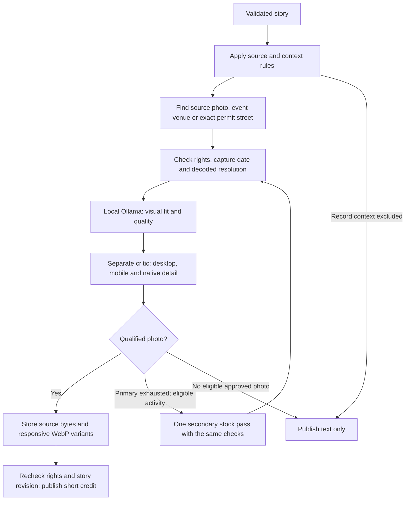

# Image pipeline: current state

The default changed to reviewed editorial illustrations on November 7, 2026. See [the illustration pipeline](illustration-pipeline.md) for current behavior and testing. The photo-only counts below are the historical November 3 investigation, not the current illustration coverage. Photo mode remains available explicitly.

Current local image refresh verified on 2026-11-03. Deployed reader:
[newsbee-seven.vercel.app/reader](https://newsbee-seven.vercel.app/reader).

## Edition data mismatch

The initial local image republish used older local editions, not the deployed editions. On
November 3 the deployed reader/API reported **76 Wedgwood items and 3 Moses Lake items**,
while local MongoDB and the local reader folder contained **2 and 1** respectively.
Wedgwood's deployed edition is `b249b89d-5a62-4e79-96dc-fc106e3b635c`, for November 3–9;
Moses Lake's is `1da5f67c-82ac-41ba-8b44-084db2812612`, for November 2–8.

The earlier local record exclusions describe only those smaller copies. Deployed Wedgwood includes
11 events, 6 sports items, 38 local/news reports, 17 obituaries and 4 safety/court items.
Moses Lake includes local news, sports and a housing record. Full published snapshots
were downloaded to ignored `.local/source-research/deployed-editions-2026-11-03/` in
the integration worktree and have now received the image pass described below. The
local refresh did not alter production or import its upstream source approvals.

## Current focused refresh

The full deployed edition snapshots were imported for local image work and republished
with their original edition IDs, story IDs, text, dates and ordering. Upstream authoring
checks were not rerun or claimed; the import records its publication provenance.

| Community | Stories | Approved image placements | Other outcomes |
| --- | ---: | ---: | --- |
| Wedgwood | 76 | 0 | 8 duplicate placements withheld; 1 venue conflict; 61 publisher-permission holds; 4 record exclusions; 1 missing venue match; 1 CPU crop-review timeout |
| Moses Lake | 3 | 0 | 2 publisher-permission holds; 1 census record exclusion |

The initial refresh repeated one photo across nine events. Eight repeated placements
were removed. The remaining mime-class placement was then withheld because the story
description names Georgetown Studios while its venue field names the Pike Place theater.
The Gum Wall photo does not resolve that conflict or show the classroom. The saved model
review incorrectly called it the correct event venue; a positive model score is not proof
of that relationship. Future reviews receive the source description, published schedule,
reported venues and photo place/caption, with explicit instructions to reject venue conflicts.

The withheld photo is CC0, by Julian Lupyan, captured 2025-11-14; its native desktop crop
is 3840×2560. Rights, freshness and resolution passed, but those checks do not establish
story relevance. Twenty local Ollama calls were recorded in the original run, including
the timeout; no additional inference or paid API calls were used for these corrections.

The public export's 29 existing image URLs did not include photo credits or capture dates,
and their reuse approvals were unavailable locally. They were withheld in this local
pass, without changing the production images or clearing publisher permission holds.
All 79 stories were retained. The corrected editions withhold all photo placements;
they render text-only until distinct, relevant photos have been approved. The reader
serves the complete local editions:

- [Wedgwood: all 76 stories](http://127.0.0.1:4322/reader/?location=osm-r13915552-wa&section=all)
- [Moses Lake: all 3 stories](http://127.0.0.1:4322/reader/?location=moses-lake-wa&section=all)

The input snapshots, story bindings, outcomes, output copies and verification report are
in ignored `.local/source-research/current-edition-images-1793744104848/` within the
integration worktree. `verification-unique-photos.json` records the uniqueness correction;
`verification-venue-correction.json` records the subsequent venue correction.
`verification-all-story-image-matching.json` audits all 79 current story decisions under
the shared matching rules. The original mime-class selection has a venue conflict; the
eight other old placements require the newer visual relationship review and remain withheld.
No additional model calls were made for this metadata audit. Current local editions are
text-only; this audit does not claim new visual approval of the withheld photos.
Reviews remain in local database
`newsbee_current_edition_images_1793744104848`; published files and approved assets use
the existing local reader storage. No credentials or private environment files were read
or changed for this refresh.

The reader retains that deployment's typography and shared design tokens. Image work
adds photographs, responsive delivery and concise credits. Summary colour and story
spacing follow the reader baseline; captions inherit its body font and spacing tokens.

## The implemented path

The stock pass runs once after primary options are exhausted. It is restricted to
suitable neutral activities and labelled **Stock Photo**. Events can use their real
venue; permits can use their actual named street in the correct city. Census/police
records do not receive context photos. An actual approved story photo is a separate
case; none was available for the record exclusions in this run.

Hard checks require documented image rights, supported formats and usable native
pixels after cropping. Context and stock require a known capture date within 365 days;
a recent upload cannot establish a recent photograph. Cards require at least 1,200
usable pixels across; leads require 1,800. Photos are never enlarged to pass the gate.
Rejection reasons, source/credit/license evidence and review results are retained.

Local Ollama uses `qwen3-vl:2b-instruct`, with no hosted fallback or API fees. Exact
source/place queries use rules; actual image and crop judgments use the model. CPU
review uses one candidate per pass and a labelled crop sheet with an unscaled
512-pixel detail sample. Published assets retain their full resolution. Failed or
incomplete model responses cannot approve a photo.

## Earlier four-community snapshot (November 2)

| Community | Stories | Approved photos | Current outcome |
| --- | ---: | ---: | --- |
| Beacon Hill | 5 | 0 | Three record exclusions; two street searches had no qualified match. |
| Wedgwood | 2 | 0 | Record context excluded. |
| Ballard | 13 | 2 | One real venue context photo and one secondary stock activity photo. |
| Moses Lake | 1 | 0 | Record context excluded. |
| **Total** | **21** | **2** | All four editions republished locally; story text unchanged. |

Across all 21 stories: **11 record exclusions, 3 publisher-photo permission holds,
5 searches without a qualified photo, and 2 selected photos**. Empty photo slots do
not render illustration placeholders.

Both approved desktop crops are **3,840 × 2,560**:

- Board-games stock: Bennett Li11; captured 2026-10-09; visible credit **Stock Photo**.
- Carkeek Park venue context: Joe Mabel; captured 2025-11-30; visible credit
  **Photo: Joe Mabel, Carkeek Park**.

The real model completed visual and crop reviews. Archived desktop/mobile variants
were verified through the local reader as WebP responses. The runtime no longer needs
the photo origin to serve those stored variants.
The reader preserves the published image decision; it does not add a curated venue
photo when the publishing pipeline withheld one.

## Readiness and remaining work

- **Implemented and exercised locally:** image selection, visual review, bounded
  retries/caching, crop criticism, durable storage, responsive delivery and short credits.
- **Verified:** 150 targeted tests passed after rebasing onto `main` at `eacb76e`,
  including image review/delivery, withheld-photo behavior, source deadlines and
  worker dispatch. Both production builds passed before that rebase. Astro reported
  zero errors, warnings or hints across 50 files before the rebase.
- **Publication scope:** local MongoDB and local Drive stand-in files. This image work
  has not been deployed to the live Vercel project.
- **Photo uniqueness:** twelve focused tests passed, including concurrent reservations,
  alternate crops, mirrored image bytes and reader compatibility. Broader image
  regressions passed; TypeScript and the reader's Astro check completed without errors.
- **Code scope:** `nkd/image_pipeline_integration`. Source commits and production
  deployment are separate steps; this local publication does not deploy the feature.
- **Secret handling:** `.local/image-vision.env` is ignored and untracked. Its contents
  must never be committed.
- **Next image focus:** increase licensed, recent source/organizer/venue coverage for
  eligible stories and reduce cold CPU review time. Keep record exclusions and rights
  gates in place; obtain evidence before clearing permission holds.

Implementation details: [image-pipeline.md](image-pipeline.md) and
[image-pipeline-agentic.md](image-pipeline-agentic.md).
