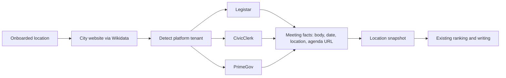

# Source connector feasibility: local politics, education, sports

Probed 2026-10-18 to choose the next source connector after library events.

## Requirement

Each connector covers **one news topic** and **discovers its sources from the location
alone** (any US town), the way the library connector goes from the IMLS directory to the
website to the feed. Sources must be official, machine-readable, and permitted for automated
access (`robots.txt`, terms of service). General news feeds that would be rewritten from other
outlets' journalism are out of scope.

## Summary

| Topic connector | Sources | Machine-readable | Location discovery | Permitted | Feasibility |
| --- | --- | --- | --- | --- | --- |
| **Local politics: city meetings** | Legistar, CivicClerk, PrimeGov, CivicPlus AgendaCenter | ✅ Public JSON APIs and RSS | ✅ Wikidata city website, then platform links | ✅ Public records | 🟢 **High**: 16/39 towns confirmed with data |
| Education: school districts | Finalsite, Apptegy sites; BoardDocs, Simbli boards | ❌ Calendars rendered by JavaScript; empty iCal | ⚠️ NCES lists every district, but the Urban Institute API has no website field | ❌ BoardDocs `robots.txt` disallows `/` | 🔴 Low |
| Sports: high school athletics | ArbiterLive, rSchoolToday, VNN, MaxPreps | ❌ No feeds found | ❌ No reliable school-to-platform mapping | ❌ MaxPreps terms prohibit scraping | 🔴 Lowest |

**Recommendation:** build a **local government meetings connector**. Meetings are dated public
events, so they fit the existing pipeline unchanged (snapshot, rank, write, publish).

**Status:** built for Legistar (agendas and recorded outcomes) and CivicClerk (agendas); see
`source_connectors\agents\government_meetings.py`. PrimeGov is recorded as blocked by its
`robots.txt`; CivicPlus AgendaCenter is not yet supported.

## Rejected: news search feeds

| Source | Finding |
| --- | --- |
| Google News RSS | Returns relevant items for any town and topic, but `news.google.com/robots.txt` disallows `/rss` and `/search` for all user agents. |
| GDELT DOC API | HTTP 429 on every request, including after a 60-second cooldown. |
| Local outlet RSS | Mixed: Lynnwood Times `/feed/` works; My Edmonds News and Edmonds Beacon return 403; HeraldNet advertises no feed. Outlets need a hand-maintained list per location, so they can't be discovered automatically. |

These are also general news rather than one topic per connector.

## Method

1. **City website discovery.** One Wikidata SPARQL query matched 40 town and state pairs to an
   official website (P856) through the place's state (P131 or P131/P131).
2. **Platform detection.** For each website: fetch the homepage, up to 4 linked pages whose
   link text or URL mentions agenda, meeting or council, and `/AgendaCenter`. Search them for
   platform tenant URLs.
3. **Feed confirmation.** For each detected tenant, and for a slug guessed from the website
   domain, call the public endpoint and require real data:

| Platform | Endpoint tested |
| --- | --- |
| Legistar | `https://webapi.legistar.com/v1/{client}/events` |
| PrimeGov | `https://{tenant}.primegov.com/api/v2/PublicPortal/ListUpcomingMeetings` |
| CivicClerk | `https://{tenant}.api.civicclerk.com/v1/Events` |
| CivicPlus AgendaCenter | `{site}/RSSFeed.aspx?ModID=65&CID=All-0` |
| Granicus | `https://{tenant}.granicus.com/ViewPublisherRSS.php?view_id=1&mode=agendas` |
| IQM2 | `https://{tenant}.iqm2.com/Services/RSS.aspx?Feed=Calendar` |

Sample: mid-sized and college towns across 30 states. This is a feasibility signal, not a
national estimate.

## Results: city meetings (39 towns)

| Measure | Result |
| --- | --- |
| Website resolved by Wikidata | 39 of 40 (Santa Cruz missing; Savannah resolved to a tourism site) |
| Structured meeting feed confirmed with data | **16** |
| Feed endpoint answered but returned no items (likely wrong category ID) | 3 (Charlottesville, Frisco, Missoula) |
| Platform detected, endpoint not yet implemented | 3 (Boise IQM2, Evanston CivicWeb, Missoula eScribe) |
| Homepage blocked the probe (403, bot protection, timeout) | 14 |

Platforms behind the 16 confirmed towns (some have more than one):

| Platform | Towns |
| --- | --- |
| Legistar | Ann Arbor, Annapolis, Columbia, Duluth, Naperville, Olympia, Redmond |
| CivicClerk | Burlington, Gainesville, Greenville, Norman, State College |
| PrimeGov | Boulder, Edmonds, Kirkland |
| CivicPlus AgendaCenter RSS | Annapolis, Ithaca, Redmond |
| Granicus RSS | Annapolis |

Legistar, CivicClerk and PrimeGov together cover 15 of the 16 confirmed towns. Ithaca is the
exception and needs CivicPlus.

Example: `edmondswa.primegov.com` returned 10 upcoming meetings with title, date and time,
location, cancellation state and agenda document list.

## Results: education and sports (first 8 towns)

Districts for Edmonds, Ames, Boulder, Naperville, Asheville, Bend, Montclair and Frisco:

| Finding | Detail |
| --- | --- |
| Website platforms | Finalsite (4), Apptegy (2; Boulder shows both), Simbli (1), unknown (1); Bend returned 403 |
| Board meetings | BoardDocs (3) disallows all crawlers in `robots.txt`; Simbli (1) |
| Calendars | Finalsite calendars render in the browser; the Edmonds `events.ics` endpoint returned 0 events |
| District discovery | The Urban Institute CCD API resolved districts by state, but has no website field |
| Athletics | Edmonds links to ArbiterLive team pages, which have no feed link; MaxPreps terms prohibit scraping |

These blockers come from the platforms themselves (crawler bans, browser rendering, terms of
service), not from the small sample. So education and sports weren't re-probed at 39-town
scale.

## Proposed meetings connector

- **Discovery:** reuse `communities/wikidata.py` for the city website. Detect tenants from
  homepage and meeting-page links, fall back to guessing slugs from the domain, and allow a
  reviewed override file (as `config/library-websites.json` does today).
- **Facts:** map each platform to the existing `EventFacts` (body and title, date, schedule,
  location, agenda link). Keep cancelled meetings flagged so they are never written as
  happening.
- **Order:** Legistar, CivicClerk and PrimeGov first; then CivicPlus RSS (fix category
  discovery), IQM2, eScribe and CivicWeb.

## Open risks

- 14 of 39 homepages blocked automated requests. Slug guessing recovered 2 (Kirkland,
  Gainesville); the rest need an override file or other discovery.
- Platform terms of use and `robots.txt` must be checked per platform before shipping. Data
  stays local-evaluation-only like library events.
- Wikidata websites can be stale (`http://`, old `ci.*` domains) or wrong (Savannah).
- Agenda item detail (what is being decided) needs a per-platform follow-up call. The
  meeting list alone gives only body, date and location.

## Wider-area connectors for news deserts (built)

When a town has little local news, editions widen to its county and state. Four connectors
are onboarded, configured per state in `config/state-sources.json`. All are free, keyless,
public and robots.txt-permitted. See the README for the ranking rules and guardrails.

| Connector | Endpoint | robots.txt | Licence / terms |
| --- | --- | --- | --- |
| USGS earthquakes | `earthquake.usgs.gov/fdsnws/event/1/query` | allowed | public domain |
| State newsrooms (WA) | Governor, WSDOT, AG and DOH RSS | allowed | public agency releases |
| Wikipedia trending | `wikimedia.org/api/rest_v1/metrics/pageviews` | allowed | CC0 data |
| Bluesky trending | `api.bsky.app/xrpc/app.bsky.unspecced.getTrends`, `searchPosts` (count only) | allowed | public AppView; no post text stored |

Rejected:
- NWS alerts: `api.weather.gov` robots.txt is `Disallow: /`, and the `alerts.weather.gov` CAP feeds are retired.
- `en.wikipedia.org/w/api.php` and `/api/rest_v1`: disallowed by robots.txt.
- Wikidata SPARQL: frequent timeouts.
- Google Trends: no official API.
- X: paid API.
- Reddit: API terms restrict commercial use.
- TikTok: research API only.

### Live test, 2026-10-19 (5 onboarded WA locations)

| Connector | Auburn | Bainbridge Island | Edmonds | Issaquah | Vancouver |
| --- | --- | --- | --- | --- | --- |
| USGS earthquakes | ingested, 2 (county) | ingested, 2 (county) | ingested, 2 (county) | ingested, 2 (town, within 30 km) | ingested, 0 within 100 km |
| State newsrooms | 4/4 feeds, 20 statewide, 1 sensitive dropped | same | same | same | same |
| Wikipedia trending | 15 topics measured, 0 trending | same | same | same | same |
| Bluesky trending | 25 national trends, 0 tied to WA; 8 town posts counted | 0 tied; 3 counted | 0 tied; 4 counted | 0 tied; 3 counted | 0 tied; 47 counted |

Wikipedia trending needs at least 2x usual views (watchlist articles). This week the
highest was Snoqualmie Pass at 1.62x (74 views a day), so nothing qualified. No
state-tied article reached the most-read lists. Town and county article attention was
0.84x to 1.3x of usual. The newsroom feeds named none of the five towns or counties in
this fortnight, so all 20 items are statewide, and ceremonial items (appointments) rank
below practical ones.

Open risks:
- One state is configured. Each new state needs reviewed newsroom feeds, a watchlist and
  county mappings.
- Bluesky trends are national, so state-tied trends will be rare.
- Wikipedia pageviews lag 1 to 3 days.
