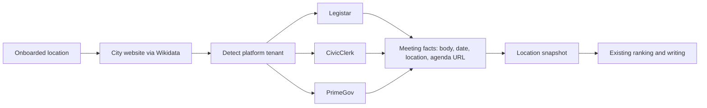

# Source connector feasibility: local politics, education, sports

Probed 2026-10-18 to choose the next source connector after library events.

## Requirement

Each connector covers **one news topic** and **discovers its sources from the location
alone** (any US town), the way the library connector goes from the IMLS directory to the
website to the feed. Sources must be official, machine-readable, and permitted for automated
access (`robots.txt`, terms of service). General news feeds that would be rewritten from other
outlets' journalism are out of scope.

## Summary

| Topic connector | Sources | Machine-readable | Location discovery | Permitted | Feasibility |
| --- | --- | --- | --- | --- | --- |
| **Local politics: city meetings** | Legistar, CivicClerk, PrimeGov, CivicPlus AgendaCenter | ✅ Public JSON APIs and RSS | ✅ Wikidata city website, then platform links | ✅ Public records | 🟢 **High**: 16/39 towns confirmed with data |
| Education: school districts | Finalsite, Apptegy sites; BoardDocs, Simbli boards | ❌ Calendars rendered by JavaScript; empty iCal | ⚠️ NCES lists every district, but the Urban Institute API has no website field | ❌ BoardDocs `robots.txt` disallows `/` | 🔴 Low |
| Sports: high school athletics | ArbiterLive, rSchoolToday, VNN, MaxPreps | ❌ No feeds found | ❌ No reliable school-to-platform mapping | ❌ MaxPreps terms prohibit scraping | 🔴 Lowest |

**Recommendation:** build a **local government meetings connector**. Meetings are dated public
events, so they fit the existing pipeline unchanged (snapshot, rank, write, publish).

**Status:** built for Legistar (agendas and recorded outcomes) and CivicClerk (agendas); see
`source_connectors\agents\government_meetings.py`. PrimeGov is recorded as blocked by its
`robots.txt`; CivicPlus AgendaCenter is not yet supported.

## Rejected: news search feeds

| Source | Finding |
| --- | --- |
| Google News RSS | Returns relevant items for any town and topic, but `news.google.com/robots.txt` disallows `/rss` and `/search` for all user agents. |
| GDELT DOC API | HTTP 429 on every request, including after a 60-second cooldown. |
| Local outlet RSS | Mixed: Lynnwood Times `/feed/` works; My Edmonds News and Edmonds Beacon return 403; HeraldNet advertises no feed. Outlets need a hand-maintained list per location, so they can't be discovered automatically. |

These are also general news rather than one topic per connector.

## Method

1. **City website discovery.** One Wikidata SPARQL query matched 40 town and state pairs to an
   official website (P856) through the place's state (P131 or P131/P131).
2. **Platform detection.** For each website: fetch the homepage, up to 4 linked pages whose
   link text or URL mentions agenda, meeting or council, and `/AgendaCenter`. Search them for
   platform tenant URLs.
3. **Feed confirmation.** For each detected tenant, and for a slug guessed from the website
   domain, call the public endpoint and require real data:

| Platform | Endpoint tested |
| --- | --- |
| Legistar | `https://webapi.legistar.com/v1/{client}/events` |
| PrimeGov | `https://{tenant}.primegov.com/api/v2/PublicPortal/ListUpcomingMeetings` |
| CivicClerk | `https://{tenant}.api.civicclerk.com/v1/Events` |
| CivicPlus AgendaCenter | `{site}/RSSFeed.aspx?ModID=65&CID=All-0` |
| Granicus | `https://{tenant}.granicus.com/ViewPublisherRSS.php?view_id=1&mode=agendas` |
| IQM2 | `https://{tenant}.iqm2.com/Services/RSS.aspx?Feed=Calendar` |

Sample: mid-sized and college towns across 30 states. This is a feasibility signal, not a
national estimate.

## Results: city meetings (39 towns)

| Measure | Result |
| --- | --- |
| Website resolved by Wikidata | 39 of 40 (Santa Cruz missing; Savannah resolved to a tourism site) |
| Structured meeting feed confirmed with data | **16** |
| Feed endpoint answered but returned no items (likely wrong category ID) | 3 (Charlottesville, Frisco, Missoula) |
| Platform detected, endpoint not yet implemented | 3 (Boise IQM2, Evanston CivicWeb, Missoula eScribe) |
| Homepage blocked the probe (403, bot protection, timeout) | 14 |

Platforms behind the 16 confirmed towns (some have more than one):

| Platform | Towns |
| --- | --- |
| Legistar | Ann Arbor, Annapolis, Columbia, Duluth, Naperville, Olympia, Redmond |
| CivicClerk | Burlington, Gainesville, Greenville, Norman, State College |
| PrimeGov | Boulder, Edmonds, Kirkland |
| CivicPlus AgendaCenter RSS | Annapolis, Ithaca, Redmond |
| Granicus RSS | Annapolis |

Legistar, CivicClerk and PrimeGov together cover 15 of the 16 confirmed towns. Ithaca is the
exception and needs CivicPlus.

Example: `edmondswa.primegov.com` returned 10 upcoming meetings with title, date and time,
location, cancellation state and agenda document list.

## Results: education and sports (first 8 towns)

Districts for Edmonds, Ames, Boulder, Naperville, Asheville, Bend, Montclair and Frisco:

| Finding | Detail |
| --- | --- |
| Website platforms | Finalsite (4), Apptegy (2; Boulder shows both), Simbli (1), unknown (1); Bend returned 403 |
| Board meetings | BoardDocs (3) disallows all crawlers in `robots.txt`; Simbli (1) |
| Calendars | Finalsite calendars render in the browser; the Edmonds `events.ics` endpoint returned 0 events |
| District discovery | The Urban Institute CCD API resolved districts by state, but has no website field |
| Athletics | Edmonds links to ArbiterLive team pages, which have no feed link; MaxPreps terms prohibit scraping |

These blockers come from the platforms themselves (crawler bans, browser rendering, terms of
service), not from the small sample. So education and sports weren't re-probed at 39-town
scale.

## Proposed meetings connector

- **Discovery:** reuse `communities/wikidata.py` for the city website. Detect tenants from
  homepage and meeting-page links, fall back to guessing slugs from the domain, and allow a
  reviewed override file (as `config/library-websites.json` does today).
- **Facts:** map each platform to the existing `EventFacts` (body and title, date, schedule,
  location, agenda link). Keep cancelled meetings flagged so they are never written as
  happening.
- **Order:** Legistar, CivicClerk and PrimeGov first; then CivicPlus RSS (fix category
  discovery), IQM2, eScribe and CivicWeb.

## Open risks

- 14 of 39 homepages blocked automated requests. Slug guessing recovered 2 (Kirkland,
  Gainesville); the rest need an override file or other discovery.
- Platform terms of use and `robots.txt` must be checked per platform before shipping. Data
  stays local-evaluation-only like library events.
- Wikidata websites can be stale (`http://`, old `ci.*` domains) or wrong (Savannah).
- Agenda item detail (what is being decided) needs a per-platform follow-up call. The
  meeting list alone gives only body, date and location.

## Wider-area connectors for news deserts (built)

When a town has little local news, editions widen to its county and to reviewed places
within 50 km; statewide stories are dropped as too far from community news. Four connectors
are onboarded, configured per state in `config/state-sources.json`. All are free, keyless,
public and robots.txt-permitted. See the README for the ranking rules and guardrails.

Relevance guardrails: weather and earthquake news must name the town, community or its
county (a mention of only a nearby place is dropped); USGS quakes beyond 15 km need
magnitude 4.0+; sponsored, paid or partner content is never rewritten. Library events
marked cancelled (feed status or title) are skipped.

| Connector | Endpoint | robots.txt | Licence / terms |
| --- | --- | --- | --- |
| USGS earthquakes | `earthquake.usgs.gov/fdsnws/event/1/query` | allowed | public domain |
| State newsrooms (WA) | Governor, WSDOT, AG and DOH RSS | allowed | public agency releases |
| Wikipedia trending | `wikimedia.org/api/rest_v1/metrics/pageviews` | allowed | CC0 data |
| Bluesky trending | `api.bsky.app/xrpc/app.bsky.unspecced.getTrends`, `searchPosts` (count only) | allowed | public AppView; no post text stored |

Rejected:
- NWS alerts: `api.weather.gov` robots.txt is `Disallow: /`, and the `alerts.weather.gov` CAP feeds are retired.
- `en.wikipedia.org/w/api.php` and `/api/rest_v1`: disallowed by robots.txt.
- Wikidata SPARQL: frequent timeouts.
- Google Trends: no official API.
- X: paid API.
- Reddit: API terms restrict commercial use.
- TikTok: research API only.

### Live test, nearby tier (5 onboarded WA locations)

| Connector | Auburn | Bainbridge Island | Edmonds | Issaquah | Vancouver |
| --- | --- | --- | --- | --- | --- |
| USGS earthquakes (50 km) | 2 nearby | 0 | 0 | 2 nearby | 0 |
| State newsrooms | 3 nearby (Tacoma Narrows, I-405 Bellevue, Tacoma AG) | 4 nearby | 2 nearby (I-405 Bellevue, Bothell) | 4 nearby | 0; 20 not near |
| Wikipedia trending | 0 (15 measured, none ≥2x) | 0 | 0 | 0 | 0 |
| Bluesky trending | 0 of 25 near | 0 | 0 | 0 | 0 |

All 20 runs ingested. A governor release that only mentioned a Seattle museum in its body
and an NFL trend whose description mentioned the Seahawks were tagged nearby on the first
run; nearby places now have to be in the headline or trend name, and both are dropped.

### Live test, 2026-10-19, statewide tier (retired)

| Connector | Auburn | Bainbridge Island | Edmonds | Issaquah | Vancouver |
| --- | --- | --- | --- | --- | --- |
| USGS earthquakes | ingested, 2 (county) | ingested, 2 (county) | ingested, 2 (county) | ingested, 2 (town, within 30 km) | ingested, 0 within 100 km |
| State newsrooms | 4/4 feeds, 20 statewide, 1 sensitive dropped | same | same | same | same |
| Wikipedia trending | 15 topics measured, 0 trending | same | same | same | same |
| Bluesky trending | 25 national trends, 0 tied to WA; 8 town posts counted | 0 tied; 3 counted | 0 tied; 4 counted | 0 tied; 3 counted | 0 tied; 47 counted |

Wikipedia trending needs at least 2x usual views (watchlist articles). This week the
highest was Snoqualmie Pass at 1.62x (74 views a day), so nothing qualified. No
state-tied article reached the most-read lists. Town and county article attention was
0.84x to 1.3x of usual. The newsroom feeds named none of the five towns or counties in
this fortnight, so all 20 items are statewide, and ceremonial items (appointments) rank
below practical ones.

Open risks:
- One state is configured. Each new state needs reviewed newsroom feeds, a watchlist and
  county mappings.
- Bluesky trends are national, so trends naming a nearby place will be rare.
- Each nearby place needs reviewed coordinates; towns with few reviewed neighbours (such as
  Vancouver) get little wider coverage.
- Wikipedia pageviews lag 1 to 3 days.

## Next connectors: civically minded parents who own or plan to own a home (design)

Probed 2026-10-21. Five connectors are planned for this reader profile. They're built one at a
time in the order below, and each follows the existing `Connector` contract
(`pipeline/connectors/types.ts`): `sources(location)` discovers from the location alone, and
`collect(task)` returns a `SourceResult` plus facts.

| # | Source type | Reader value | Machine-readable | Location discovery | Permitted | Feasibility |
| --- | --- | --- | --- | --- | --- | --- |
| 1 | `civiccalendar`: city and parks calendars | Family events, parks and rec, town halls | ✅ CivicPlus iCalendar feed | ✅ City website from the meetings connector | ✅ Redmond `robots.txt` doesn't block `/common/modules/iCalendar/` | 🟢 High |
| 2 | `development`: permits and land use | New construction near home | ✅ Socrata SODA JSON | ⚠️ Catalog search per city domain | ✅ Open data licences | 🟡 Medium |
| 3 | `homesafety`: disasters and drinking water | Water safety, disaster aid | ✅ OpenFEMA and EPA Envirofacts JSON | ⚠️ County FIPS (FEMA); water system by city (EPA) | ✅ Public domain | 🟢 High |
| 4 | `housing`: real estate market | Home values, new housing supply | ✅ CSV and fixed-width text | ✅ Census place GEOID; city and state name | ✅ Public domain (Census, FHFA); Zillow needs attribution | 🟢 High |
| 5 | `athletics`: high school team results | Community pride in local teams | ⚠️ WordPress RSS for news only; brackets are HTML | ⚠️ State association per state; school by name | ⚠️ Varies by state | 🟡 Medium-low |

### 1. City and parks calendars (`civiccalendar`)

- **Discovery:** reuse `LocationProfile.government.website`. On CivicPlus sites, read the
  calendar page's category list (`/Calendar.aspx`), then build
  `/common/modules/iCalendar/iCalendar.aspx?catID={id}&feed=calendar` for each category.
  Cache the result in the link cache.
- **Probe:** Redmond's feed answered with a valid `VCALENDAR`, but the guessed `catID=14` had 0
  events, so category discovery must be real, not guessed.
- **Facts:** parse with the library connector's ICS parser into `EventFacts`. Tag
  `kind: "parks" | "community" | "civic"` from the category name, and skip categories that are
  meetings, because the meetings connector already covers them.
- **Ranking:** family-friendly and free events rank highest. Cancelled events are skipped.

### 2. Development and permits (`development`)

- **Discovery:** call `api.us.socrata.com/api/catalog/v1?q=permits&search_context={domain}`.
  Try the domain from the city website (`data.{city}.gov`), then let a reviewed override file
  map a location to its dataset ID. Probe: Seattle had 19 permit datasets, Austin 149 and
  Norfolk 10; Bellevue had no portal.
- **Facts:** these are filings, not events. Add a `FilingFacts` type: kind (new construction,
  demolition, rezone), address, valuation, units, filed or issued date, and a source URL.
  Only new construction, demolition, multi-unit and rezoning permits are kept; small repair
  permits are dropped.
- **Ranking:** larger projects (units or value) and filings close to the location's centre rank
  higher. Owners' names are never written; addresses are only used for commercial and
  multi-unit projects.
- **Risk:** mostly larger cities publish permit data. Towns without a portal fall back to the
  Census permit counts in the `housing` connector.

### 3. Home and family safety (`homesafety`)

Extends the existing `hazards` connector rather than adding a new one.

- **FEMA:** `fema.gov/api/open/v2/DisasterDeclarationsSummaries`, filtered by state and the
  location's county FIPS. New declarations name the aid programmes (individual or public
  assistance) that are open to homeowners.
- **EPA drinking water:** `data.epa.gov/efservice/...` for Safe Drinking Water violations by
  water system. Discovery maps the location to its water systems through
  `GEOGRAPHIC_AREA` (city served). The probe's lookup returned 0 systems for Redmond, so the
  fallback is county served, followed by a reviewed override.
- **Guardrails:** only health-based violations (not paperwork-only "monitoring and reporting")
  are written, and only when they're new or still open in the window. Each story links the
  official notice.

### 4. Real estate market (`housing`)

Market data only. Listing sites aren't used: Redfin's `robots.txt` blocks `/stingray/`
except listing RSS, and individual listings and sale prices would name homeowners.

| Source | Endpoint | Grain | Licence |
| --- | --- | --- | --- |
| Census Building Permits Survey | `www2.census.gov/econ/bps/Place/{Region}/{rr}{yymm}c.txt` | Place, monthly | Public domain |
| Zillow Research home values (ZHVI) | `files.zillowstatic.com/research/public_csvs/zhvi/City_zhvi_...csv` (94 MB) | City, monthly | Free with attribution to Zillow |
| FHFA house price index | `fhfa.gov/hpi/download/quarterly_datasets/hpi_at_3zip.csv` (3 MB) | 3-digit ZIP, quarterly | Public domain |

- **Discovery:** match the Census place (state FIPS and place name or code) from
  `LocationProfile.census_geoid`. The probe found an Edmonds row in the August 2025 West
  file; the Redmond row was Redmond, Oregon, so matching must use the state, not just the
  name.
- **Collection:** these are large monthly files. Download and parse each file once per release
  into MongoDB, shared by all locations, instead of once per location. Redfin's city tracker
  (1 GB) is skipped.
- **Facts:** add a `MetricFacts` type: metric, period, value, change since last month and last
  year, and the source. Only notable changes are written (for example, value up or down
  5%+ year on year, or permits at a 12-month high). Edition copy states the period, because
  the data is 1 to 2 months old.

### 5. High school athletics: team results only (`athletics`)

Collect only where the state association's `robots.txt` and terms allow automated access.
Team-level results only: **no student names, photos or individual stats**, because they're
minors. School district sites and MaxPreps aren't used.

| State association | Probe | Status |
| --- | --- | --- |
| WIAA (WA) | `/feed/` RSS works (news); brackets are on `wpanetwork.com`; no `robots.txt` (404) | ⚠️ News feed usable; brackets need terms review |
| OSAA (OR) | `robots.txt` blocks `/brackets/`, `/teams/` and `/contests/`; homepage returns 403 | ❌ Blocked |
| IHSA (IL) | `robots.txt` allows `*` except `/schools/trends/`, but declares content-use signals | ⚠️ Terms review needed |
| CHSAA (CO) | No `robots.txt` (404) | ⚠️ Terms review needed |
| MaxPreps | `robots.txt` blocks `/school/` and `/team/`; terms prohibit scraping | ❌ Blocked |

- **Discovery:** a reviewed per-state config (as `config/state-sources.json` does for state
  newsrooms) gives the association feed. Schools are matched to the location from NCES
  public school names, without their websites.
- **Facts:** state tournament advancement and results for schools in the location ("Edmonds-
  Woodway girls soccer advances to state quarterfinals"). Items without a local school are
  dropped.
- **Risk:** coverage is per state and needs a terms review before each state is enabled.
  Expect only some states to qualify, and mostly tournament-season results.

### Build order

1. `civiccalendar`: the smallest change; it reuses city website discovery and the ICS parser.
2. `homesafety`: extends `hazards` with two keyless JSON APIs.
3. `housing`: needs the new `MetricFacts` type and shared monthly ingest.
4. `development`: needs the new `FilingFacts` type and per-city dataset discovery.
5. `athletics`: needs a terms review for each state before enabling it.

Each connector ships with recorded fixtures under `pipeline/tests/fixtures/{type}/`, a
connector test, a ranker in `pipeline/ranking/` and an entry in `SOURCE_TYPES` and
`CONNECTORS`.
