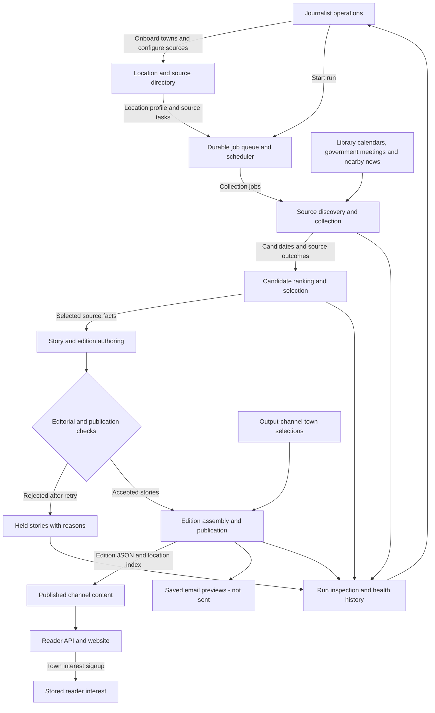
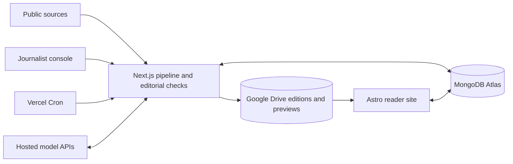

# Newsbee

Newsbee writes community newspapers from library events, government meetings and nearby
news. The active application is a TypeScript cloud stack: a Next.js journalist console
and pipeline, an Astro reader site, MongoDB Atlas, Google Drive and hosted model APIs.
The earlier Python prototype is [archived for reference](archive/python/README.md), not
part of the build or a supported runtime.

## Logical architecture and data flow

Each location's run gathers source candidates, ranks them, writes and checks stories,
then publishes the accepted content to its selected output channels.



The queue runs collection, authoring and publication as bounded jobs. Source failures and
held stories remain visible to editors without blocking the rest of a location's edition.

## Technology stack



## Run the cloud stack locally

Install Node.js 24 (npm 11) and [Ollama](https://ollama.com/download), then run from the
repository root:

```text
ollama pull qwen3:4b
npm --prefix apps/journalist-site ci
npm --prefix apps/reader-site ci
npm --prefix apps/journalist-site run local
```

This starts the journalist console at http://127.0.0.1:3000, the reader at
http://127.0.0.1:4321, a persistent local MongoDB and scheduler ticks. Google sign-in
is skipped on localhost; Drive files and MongoDB data live under ignored `.local/stage2/`.
The first run downloads MongoDB. No Python, uv or Mailpit is required.
Hosted model providers can replace Ollama; see the [journalist guide](apps/journalist-site/README.md).

In **Runs & locations**, search for and add a town, then **Start run**. Directories are
prepared on first use. Select the town in **Output channel** and save to expose it on the
reader. Email previews are saved, not sent.

## Deploy

Create two Vercel projects with root directories `apps/journalist-site` and
`apps/reader-site`. Enable access to files outside each project's root directory so the
journalist build can bundle root `config/` seeds and both apps can import `shared/` code.
The journalist project uses `NEWSBEE_MODE=cloud`, MongoDB Atlas, a Drive writer service
account, hosted model credentials, Google sign-in and `CRON_SECRET`. Its minute cron
requires Vercel Pro. Seed an enabled account in `journalist_admins` before signing in.
The reader uses MongoDB and a Drive service account with Viewer access to its configured
output-channel folder; keep all credentials server-side.

Full environment and setup details: [journalist/pipeline](apps/journalist-site/README.md),
[reader](apps/reader-site/README.md), [runtime boundaries](Docs/production-architecture-decisions.md).

## Develop

```text
npm --prefix apps/journalist-site test
npm --prefix apps/journalist-site run lint
npm --prefix apps/journalist-site run build
npm --prefix apps/reader-site run check
npm --prefix apps/reader-site run build
```

Pipeline tests and replay fixtures live alongside the TypeScript implementation. Tests
use fake model/network responses and a local MongoDB test server, not cloud credentials.
There is no repository CI workflow currently; run these commands before submitting changes.

| Path | Purpose |
| --- | --- |
| `apps/journalist-site/` | Next.js operations console, TypeScript pipeline, tests and local-stack launcher |
| `apps/reader-site/` | Astro reader and server-side public API |
| `shared/` | Cross-app code and language-neutral edition/health/metrics contracts |
| `config/` | Reviewed source overrides bundled as MongoDB seed data |
| `Docs/` | Current architecture decisions, source research and historical design/roadmap assets |
| `archive/python/` | Historical Python backend, review console, launcher, tests and dependency lock |
