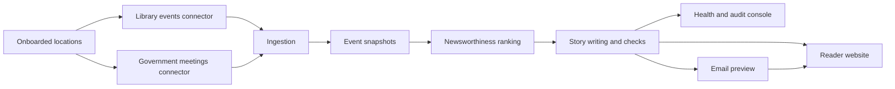

# Newsbee
CSE589 UW Entrepreneurship Prototyping

Local Stage 1 **private proof of concept** for one shared, digestible community edition.
Sources are library events and local government meetings; editions publish after each ingestion.
This is a curated listings/meeting digest, not yet a comprehensive local newspaper.
Sensitive material is held, not automatically approved. Nothing here enables public distribution.



## Setup

Install [uv](https://docs.astral.sh/uv/getting-started/installation/),
[Node.js 24](https://nodejs.org/en/download),
[Mailpit](https://mailpit.axllent.org/docs/install/) and
[Ollama](https://ollama.com/download), then:

```text
ollama pull qwen3:4b
uv run --locked python scripts/dev.py setup --browser
uv run --locked python scripts/dev.py up
```

| Page | URL |
| --- | --- |
| Reader website | http://127.0.0.1:4321 |
| Health dashboard and review | http://127.0.0.1:8000/review |
| API docs | http://127.0.0.1:8000/docs |
| Email previews (Mailpit) | http://127.0.0.1:8025 |

Localhost only, no authentication. Logs go to `.local/logs/`.

## Commands

In a second terminal (prefix each with `uv run --locked python scripts/dev.py`):

| Command | Does |
| --- | --- |
| `setup-directory` | Download the US library directory (once) |
| `find-location Edmonds` | List matching towns and ids |
| `onboard edmonds-wa` | Add a location and find its library websites and meeting platform |
| `remove-location <id>` | Delete a location and all its data |
| `ingest-events` | Pull 7 days of events and meeting agendas from tomorrow, plus the past 7 days' recorded meeting decisions, then author editions |
| `author-edition <id>` | Re-author one location |
| `withdraw-story <edition id> --story <story id> --reason "<public explanation>"` | Remove a published story, show a correction, and prevent its automatic return |
| `replay` | Offline Stage 1 gate; saves `.local/stage-one-replay.xml` |
| `events` | List jobs and stored events |

If a library website isn't found, add it to `config/library-websites.json` and re-run
`onboard`. Library data is for local evaluation only; don't commit or redistribute it.

Government meetings come from the town's Legistar or CivicClerk public API, found via the
town website (Wikidata) or its name. If `onboard` reports no platform, add
`{"<location id>": {"platform": "legistar", "tenant": "<name>"}}` to
`config/government-sources.json` and re-run `onboard`. Each meeting story opens with what
the public body does; procedural items (roll call, minutes) and private individuals' cases
are left out. Outcomes are the clerk's recorded actions; CivicClerk records none, so it
supplies agendas only.

## Authoring

1. **Deduplicate** repeated events into one story.
2. **Rank** in two steps. Each source type ranks its full pool and shortlists its top 5
   by its own rules: library events put one-off events, then practical help, first;
   meetings put the city council first, then sooner meetings and fuller agendas. The model then
   ranks the shortlists together (civic 3 : appeal 2 : one-off 1). Meeting coverage precedes
   discretionary events and is not suppressed by the one-per-category variety rule.
3. **Check eligibility**, then **write** up to 5 stories. Missing source context/HTTPS links,
   allegations, individual cases and other sensitive patterns are held before writing.
   Events use one story per category; distinct meetings remain independently eligible.
   Drafts that add unsupported words, repeat
   themselves, stop mid-sentence, drift into non-Latin characters or leave the event's own
   name out of the headline get one retry, then are held for audit at `/review/editions`.
   These are conservative heuristics, **not proof of factuality or a complete sensitivity detector**.
4. **Front** headline naming the top story (same checks and one retry, else a fixed fallback).
5. **Email** a preview (headline, intro, a teaser blurb and a link to the website) to the
   test subscribers for that location in `config/preview-subscribers.json`. Failed sends
   retry and show on the health page.

### Processing speed and recovery

Unchanged, successfully checked story prose is cached in SQLite per community, source text,
venue, kind, model and validation policy. Each reuse passes current checks; source dates,
links and ranking metadata are rebuilt from the current snapshot. Changed evidence or policy
invalidates reuse. Interrupted authoring can reuse completed story work rather than regenerate it.
Held drafts are never cached; withdrawals are checked before reuse.

With five unchanged stories this avoids five of the usual eight generation calls (ranking,
five stories, front and email), before retries. The fixture check verifies eight calls become
three for a five-story edition. These are **call-count savings, not measured latency claims**.
Ollama may now select available GPU acceleration instead of being forced onto the CPU;
CPU-only machines still work. Only one worker is supported; increasing model concurrency
without hardware measurements is deliberately avoided.

### Corrections

Find the edition and story IDs in `/review/editions`, then use `withdraw-story` with a
10-500 character explanation suitable for readers. The withdrawal applies to that community's
matching story in every edition and future authoring (including renamed source records),
preserves original audit evidence, and
cannot silently overwrite its reason. The website removes the story, replaces potentially
stale front copy and displays the correction. Unsent previews use corrected wording.
Already-sent Mailpit messages are not recalled.

This intentionally supports **withdrawal**, not arbitrary replacement reporting or automatic
reinstatement. A withdrawn recurring event stays held. Edits, reinstatement, correction emails
and an assigned exception/review workflow remain future editorial work.

## Stage 1 readiness assessment

The [product spec](Docs/newsbee-design-spec-v1.html) describes the eventual product;
the [v1 roadmap](Docs/newsbee-implementation-roadmap-v1.html) explicitly makes Stage 1 a private,
all-local POC, not a public MVP launch. Neither document's proposed rules have been silently
treated as ratified policy.

| Stage 1 requirement | Current evidence / limitation |
| --- | --- |
| Source to website and email preview | Working pipeline, visible attribution, Mailpit-only delivery and per-recipient retries |
| Two communities, two connectors, three weeks | `replay` runs real library RSS and Legistar connector code over synthetic responses, producing six distinct community/week editions; inference is mocked |
| Inspectable source support | Immutable snapshots, normalized facts, original HTTPS links, retrieval/evidence records and retained draft audit; not claim-level entailment verification |
| Deduplication and local selection | Repeated events collapsed; council stories no longer lost to random sampling; previews/outcomes and separate meeting dates stay distinct |
| Seeded risks held | Pre-writing sensitive/context/source checks plus generated-text checks; no approval by timeout |
| Restart and retry | Persistent jobs, expiring leases, bounded ingestion/delivery retries and checked-prose recovery after interrupted authoring |
| Corrections | Audited withdrawal, reader-visible notice, stale front removal and suppression on subsequent runs |
| Honest reader experience | Source names/types, missing-coverage disclosure, past-edition warning, mobile layout, retry button and empty-copy that does not imply nothing happened |
| Ongoing reporting, review, ads | Not implemented as full workflows; ads can stay absent, sensitive coverage stays held, and meeting history is not a maintained reporting thread |

### What is still needed before calling Stage 1 ready

1. **Choose two actual pilot communities and verify source use.** The directory and overrides
   make onboarding possible, but source permissions remain unresolved. Review live branch matches,
   meeting-body scope, agenda completeness and missing sources. Synthetic replay is not evidence
   that either town has enough useful live coverage.
2. **Run the local model and inspect six real trial editions.** Agree the model/license and
   supported team machines. Compare every material claim, negation, decision status, date, location
   and source link with its evidence. Word-overlap checks cannot establish those relationships.
   Record usefulness, held/error counts, warm/cold processing time and human minutes per community.
3. **Name an operator and ratify the narrow coverage policy.** Decide essential coverage, mandatory
   holds, minimum useful edition size, exception response/expiry and correction responsibilities.
   Until then, do not widen autonomy beyond library listings and routine public-meeting digests.
4. **Rehearse operations on the target machine.** Run replay and model evaluation, stop/restart the
   worker, retry Mailpit delivery, withdraw a seeded bad story and restore a backup. With the stack
   stopped, back up the entire `.local/data` directory (database and evidence together), restore it
   to a separate directory, and launch with `NEWSBEE_DATA_DIR` pointing there. This is a manual
   restore drill, not an implemented backup system.
5. **Agree a weekly release cadence.** Current ingestion publishes immediately for iteration.
   A single designated operator should trigger each weekly private edition; replay can be invoked
   by the team's local scheduler. Frozen releases, archives and automated weekly delivery are not
   implemented.

Keep public hosting/authentication, real subscriber consent/unsubscribe, analytics/adaptation,
advertising intake, broad sensitive reporting and microservices out of this POC.
Public subscriptions and distribution belong to Stage 2, not this readiness claim.

## Development

```text
uv run --locked python scripts/dev.py test      # critical offline checks only
uv run --locked python scripts/dev.py replay    # exit-gate replay plus safety/recovery checks
uv run --locked python scripts/dev.py browser   # critical reader browser checks
uv run --locked python scripts/dev.py test-all  # optional broader offline regression
uv run --locked ruff check .
```

Run `scripts/dev.py contracts` after changing `shared/contracts`. Optional settings
(`NEWSBEE_DATA_DIR`, `NEWSBEE_OLLAMA_URL`, `NEWSBEE_OLLAMA_MODEL`, ...) all have defaults.

| Folder | Holds |
| --- | --- |
| `projects/backend` | API, pipeline modules, shared adapters ([map](projects/backend/README.md)) |
| `projects/website` | Minimal reader site |
| `projects/review-console` | Minimal review and health pages |
| `shared/contracts` | Contracts shared between projects |
| `config` | Library website and government platform overrides, preview subscribers, policies |
| `tests` | Unit, integration, end-to-end ([map](tests/README.md)) |
| `Docs` | [Design spec](Docs/newsbee-design-spec-v1.html), [roadmap](Docs/newsbee-implementation-roadmap-v1.html) |
