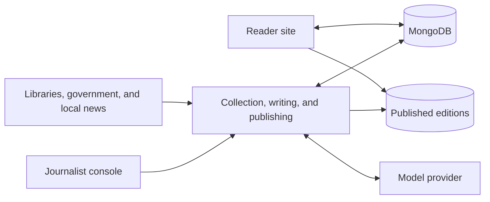
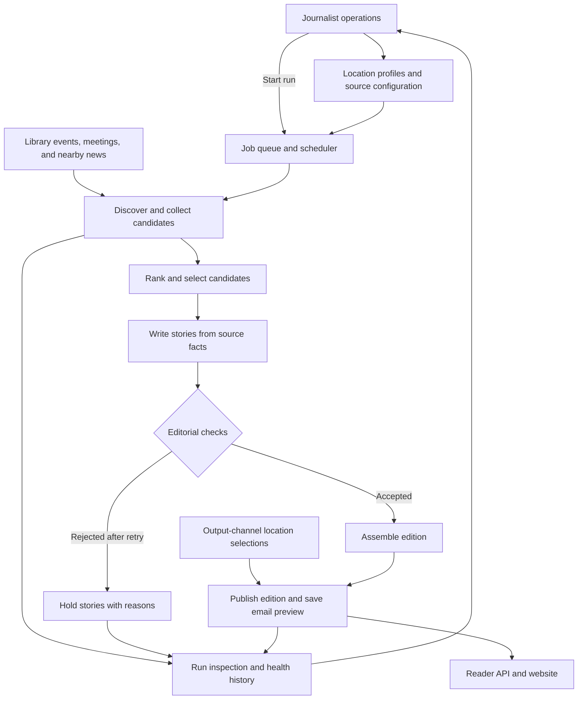

# Newsbee

Newsbee turns community events, public meetings, and nearby news into local newspaper editions. It has a journalist console and pipeline, plus a public reader site.

## Architecture

### Components



### Logical pipeline flow



## Run locally

Requirements: Node.js 24, npm 11, and [Ollama](https://ollama.com/download).

From the repository root:

```text
ollama pull qwen3:4b
npm --prefix apps/journalist-site ci
npm --prefix apps/reader-site ci
npm --prefix apps/journalist-site run local
```

This starts the journalist console at http://127.0.0.1:3000, the reader at
http://127.0.0.1:4321/reader, a persistent local MongoDB and scheduler ticks. Google sign-in
is skipped on localhost; Drive files and MongoDB data live under ignored `.local/stage2/`.
The first run downloads MongoDB. No Python, uv or Mailpit is required.
Hosted model providers can replace Ollama; see the [journalist guide](apps/journalist-site/README.md).

In **Runs & locations**, search for a community, select and add it, then start a run.
New locations are automatically enabled for reader-site publishing and appear after
their first published edition. Expand **Publishing settings** on the same page to
disable a location if needed. Email previews are saved, not sent.

## Source connectors

The pipeline currently registers ten connector types. Availability depends on each
location's configured sources, supported platforms and geographic coverage; missing or
blocked sources are reported in **Connectors & links** and run inspection.

| Connector | Current coverage |
| --- | --- |
| Library events (`library`) | Selected library branches, using BiblioCommons, Trumba RSS, iCalendar or JSON-LD event listings. |
| Public meetings (`meetings`) | Legistar and CivicClerk agendas and meeting details; neighborhood coverage filters agenda items for local relevance. |
| Earthquakes (`hazards`) | USGS earthquake records around the location, with distance and magnitude context. |
| Community and state news (`statenews`) | Reviewed or validated RSS/Atom newsroom feeds, retaining geographically relevant reporting and announcements. |
| Local reporting discovery (`trending`) | Wikipedia and Bluesky discover linked reporting; publication requires verified local context, not popularity alone. |
| City and parks calendars (`civiccalendar`) | CivicPlus community and parks iCalendar feeds; meeting categories are left to the meetings connector. |
| Drinking-water safety (`homesafety`) | EPA Envirofacts/SDWIS health-based violations for community water systems serving the town or nearby places. |
| Housing permits (`housing`) | Census Building Permits Survey estimates matched to the town's Census place; not property listings or neighborhood-level estimates. |
| Development permits (`development`) | Geographically filtered new-construction and multi-unit permit records from supported city Socrata portals; minor work is excluded and single-family addresses are withheld. |
| School athletics (`athletics`) | Reviewed state athletic-association feeds, limited to team-level sports headlines naming the town or nearby places; individual-student stories are excluded. |

Every eligible collected item is published as a listing. Authoring writes stories from the
whole ranked pool, with no cap unless `NEWSBEE_MAX_STORIES` or
`NEWSBEE_STORY_CANDIDATES_PER_SOURCE` is set (see [Limits](apps/journalist-site/README.md#limits)). Held stories retain their reasons and do not consume publication
slots. Published items retain ranked order; the reader groups them into news and
upcoming-event sections. See the [journalist guide](apps/journalist-site/README.md)
for configuration, geographic limits and the manual authoring/publication gates.

## Pages

**Journalist console**

- **Runs & locations** (`/`) — Search for and add a town or neighborhood, start or inspect its pipeline run, and review results. Expand **Publishing settings** to choose the reader site's towns, update its URL, or enable/disable publishing.
- **Health** (`/health`) — Check system and location status, model usage, and run trends.
- **Connectors & links** (`/sources`) — Review source connectors and coverage; validate and save a source link for a location.
- **Administrators** (`/administrators`) — Manage journalist-console administrator access.

**Reader site**

- **Find your neighborhood** (`/reader`) — Choose a published edition or search for a US town or neighborhood. Published communities open their newspaper; communities without an edition open the “we're not here yet” interest page.

## Deploy

Create one Vercel project with its Root Directory set to the repository root and
Node.js 24 selected. The root `vercel.json` builds two services independently:

| Service | Public paths |
| --- | --- |
| `journalist-site` (Next.js) | `/` and all paths outside `/reader`, including `/api/auth/*`, `/api/admin/*` and `/api/pipeline/*` |
| `reader-site` (Astro) | `/reader`, `/reader/api/*` and `/reader/_astro/*` |

The reader rewrites select base-relative Astro output paths with `destination.path`;
Vercel still passes the original `/reader/...` request path to the application.

The archived Python prototype is not deployed. There are no inter-service HTTP calls
or service bindings: each app accesses MongoDB and Drive directly. The journalist
pipeline self-call stays within the journalist service. Queue consumers remain private,
even though the journalist service has public routes.

Project environment variables are shared by both services. Set `NEWSBEE_MODE=cloud`,
`MONGODB_URI`, `MONGODB_DATABASE`, model-provider credentials, Google sign-in credentials
and `AUTH_SECRET`. Set `NEWSBEE_READER_SITE_URL=https://<your-domain>/reader` before
initializing the default channel; update existing channel URLs in **Publishing settings**.
The OAuth callback remains `https://<your-domain>/api/auth/callback/google`. Seed an
enabled account in `journalist_admins` before signing in.

Both apps currently read `GOOGLE_SERVICE_ACCOUNT_EMAIL` and
`GOOGLE_SERVICE_ACCOUNT_PRIVATE_KEY`. To preserve separate Drive identities within
the shared environment, put the **reader** credentials in those two variables and
the **writer's complete JSON key** in `GOOGLE_SERVICE_ACCOUNT_JSON` (which only the
journalist adapter reads). Also set `NEWSBEE_PIPELINE_DRIVE_FOLDER_ID` for the writer.
Grant the writer write access and the reader Viewer access to the channel folder;
keep all credentials server-side. Shared environment variables are not a security
boundary between the services. Both Drive adapters support Workspace Shared drives.
Use folders in a Shared drive for service-account publishing: service accounts
cannot own new files in personal My Drive. A folder shared from My Drive is not
a Workspace Shared drive, and Vercel configuration does not change that limitation.

The journalist service's `functions` configuration in root `vercel.json` preserves
the Vercel Queues trigger for portal-started runs. Optional Cron recovery is not
enabled; enabling it requires `CRON_SECRET` and an appropriate Vercel plan.

To exercise the single-domain routing locally, install both apps' dependencies with
the `npm ci` commands above, configure local MongoDB/Drive/model settings, and run
`npx vercel dev -L` from the repository root. The console is at `/` and the reader
at `/reader` on the URL printed by Vercel. `vercel dev` does not start MongoDB or
Ollama; the existing `npm --prefix apps/journalist-site run local` launcher remains
available for the standalone local stack.

Vercel CLI 64 currently rejects service-hosted queue triggers in local mode
(`DEV_QUEUE_FUNCTION_UNSUPPORTED`). For routing-only checks, use a temporary copy
of `vercel.json` without the journalist `functions` entry and pass it with
`vercel dev -L --local-config <temporary-config>`. Keep the queue trigger in the
production config; queue delivery must be checked in a deployment.
## Develop

```text
npm --prefix apps/journalist-site test
npm --prefix apps/journalist-site run lint
npm --prefix apps/reader-site run check
```

For deployment and environment setup, see the [journalist-site guide](apps/journalist-site/README.md) and [reader-site guide](apps/reader-site/README.md). The [production architecture decisions](Docs/production-architecture-decisions.md) describe runtime boundaries. The earlier Python prototype is archived in [archive/python](archive/python/README.md).
