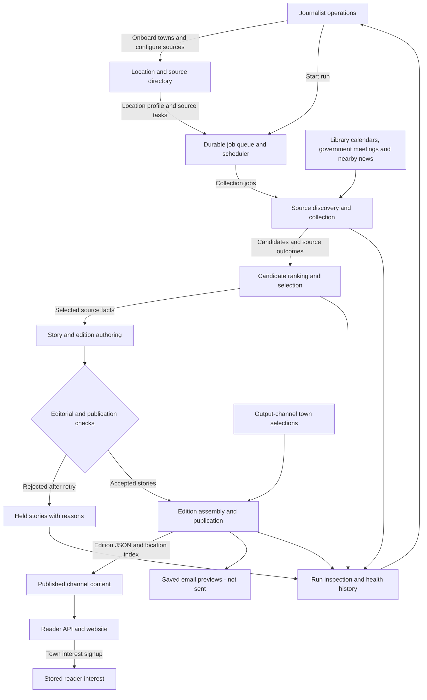
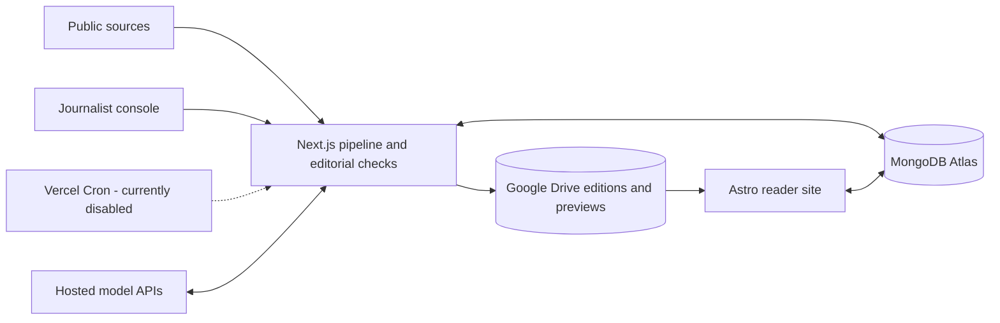

# Newsbee

Newsbee writes community newspapers from library events, government meetings and nearby
news. The active application is a TypeScript cloud stack: a Next.js journalist console
and pipeline, an Astro reader site, MongoDB Atlas, Google Drive and hosted model APIs.
The earlier Python prototype is [archived for reference](archive/python/README.md), not
part of the build or a supported runtime.

## Logical architecture and data flow

Each location's run gathers source candidates, ranks them, writes and checks stories,
then publishes the accepted content to its selected output channels.



The queue runs collection, authoring and publication as bounded jobs. Source failures and
held stories remain visible to editors without blocking the rest of a location's edition.

## Technology stack



## Run the cloud stack locally

Install Node.js 24 (npm 11) and [Ollama](https://ollama.com/download), then run from the
repository root:

```text
ollama pull qwen3:4b
npm --prefix apps/journalist-site ci
npm --prefix apps/reader-site ci
npm --prefix apps/journalist-site run local
```

This starts the journalist console at http://127.0.0.1:3000, the reader at
http://127.0.0.1:4321/reader, a persistent local MongoDB and scheduler ticks. Google sign-in
is skipped on localhost; Drive files and MongoDB data live under ignored `.local/stage2/`.
The first run downloads MongoDB. No Python, uv or Mailpit is required.
Hosted model providers can replace Ollama; see the [journalist guide](apps/journalist-site/README.md).

In **Runs & locations**, enter a neighborhood and city/state and press **Search all communities**
or Enter, select a result, then add it. OpenStreetMap/Photon discovery is not restricted to
a neighborhood catalog: try **Wallingford, Seattle, Washington**, **Ballard**, or
**West Seattle, WA**. Existing Census town/city suggestions remain available. Review the
reported coverage area and source gaps before **Start run**. Neighborhood editions use scoped library branches and community-relevant
news rather than the whole parent city's news. See [community coverage](apps/journalist-site/README.md#neighborhood-and-community-coverage).
Directories are
prepared on first use. Select the town in **Output channel** and save to expose it on the
reader. Email previews are saved, not sent.

## Deploy

Create one Vercel project with its Root Directory set to the repository root and
Node.js 24 selected. The root `vercel.json` builds two services independently:

| Service | Public paths |
| --- | --- |
| `journalist-site` (Next.js) | `/` and all paths outside `/reader`, including `/api/auth/*`, `/api/admin/*` and `/api/pipeline/*` |
| `reader-site` (Astro) | `/reader`, `/reader/api/*` and `/reader/_astro/*` |

The reader rewrites select base-relative Astro output paths with `destination.path`;
Vercel still passes the original `/reader/...` request path to the application.

The archived Python prototype is not deployed. There are no inter-service HTTP calls
or service bindings: each app accesses MongoDB and Drive directly. The journalist
pipeline self-call stays within the journalist service. Queue consumers remain private,
even though the journalist service has public routes.

Project environment variables are shared by both services. Set `NEWSBEE_MODE=cloud`,
`MONGODB_URI`, `MONGODB_DATABASE`, model-provider credentials, Google sign-in credentials
and `AUTH_SECRET`. Set `NEWSBEE_READER_SITE_URL=https://<your-domain>/reader` before
initializing the default channel; update existing channel URLs in **Output channel**.
The OAuth callback remains `https://<your-domain>/api/auth/callback/google`. Seed an
enabled account in `journalist_admins` before signing in.

Both apps currently read `GOOGLE_SERVICE_ACCOUNT_EMAIL` and
`GOOGLE_SERVICE_ACCOUNT_PRIVATE_KEY`. To preserve separate Drive identities within
the shared environment, put the **reader** credentials in those two variables and
the **writer's complete JSON key** in `GOOGLE_SERVICE_ACCOUNT_JSON` (which only the
journalist adapter reads). Also set `NEWSBEE_PIPELINE_DRIVE_FOLDER_ID` for the writer.
Grant the writer write access and the reader Viewer access to the channel folder;
keep all credentials server-side. Shared environment variables are not a security
boundary between the services. The current Drive adapters still need Shared-drive
API support for service-account publishing; configuring Vercel does not resolve
Drive ownership/quota limitations.

The journalist service's `functions` configuration in root `vercel.json` preserves
the Vercel Queues trigger for portal-started runs. Optional Cron recovery is not
enabled; enabling it requires `CRON_SECRET` and an appropriate Vercel plan.

To exercise the single-domain routing locally, install both apps' dependencies with
the `npm ci` commands above, configure local MongoDB/Drive/model settings, and run
`npx vercel dev -L` from the repository root. The console is at `/` and the reader
at `/reader` on the URL printed by Vercel. `vercel dev` does not start MongoDB or
Ollama; the existing `npm --prefix apps/journalist-site run local` launcher remains
available for the standalone local stack.

Vercel CLI 64 currently rejects service-hosted queue triggers in local mode
(`DEV_QUEUE_FUNCTION_UNSUPPORTED`). For routing-only checks, use a temporary copy
of `vercel.json` without the journalist `functions` entry and pass it with
`vercel dev -L --local-config <temporary-config>`. Keep the queue trigger in the
production config; queue delivery must be checked in a deployment.

Full environment and setup details: [journalist/pipeline](apps/journalist-site/README.md),
[reader](apps/reader-site/README.md), [runtime boundaries](Docs/production-architecture-decisions.md),
and the [operations inventory](Docs/operations-inventory.md) (project IDs, service accounts,
Drive folders and deployment verification gaps).

## Develop

```text
npm --prefix apps/journalist-site test
npm --prefix apps/journalist-site run lint
npm --prefix apps/journalist-site run build
npm --prefix apps/reader-site run check
npm --prefix apps/reader-site run build
```

Pipeline tests and replay fixtures live alongside the TypeScript implementation. Tests
use fake model/network responses and a local MongoDB test server, not cloud credentials.
There is no repository CI workflow currently; run these commands before submitting changes.

| Path | Purpose |
| --- | --- |
| `apps/journalist-site/` | Next.js operations console, TypeScript pipeline, tests and local-stack launcher |
| `apps/reader-site/` | Astro reader and server-side public API |
| `shared/` | Cross-app code and language-neutral edition/health/metrics contracts |
| `config/` | Reviewed source overrides bundled as MongoDB seed data |
| `Docs/` | Current architecture decisions, source research and historical design/roadmap assets |
| `archive/python/` | Historical Python backend, review console, launcher, tests and dependency lock |
