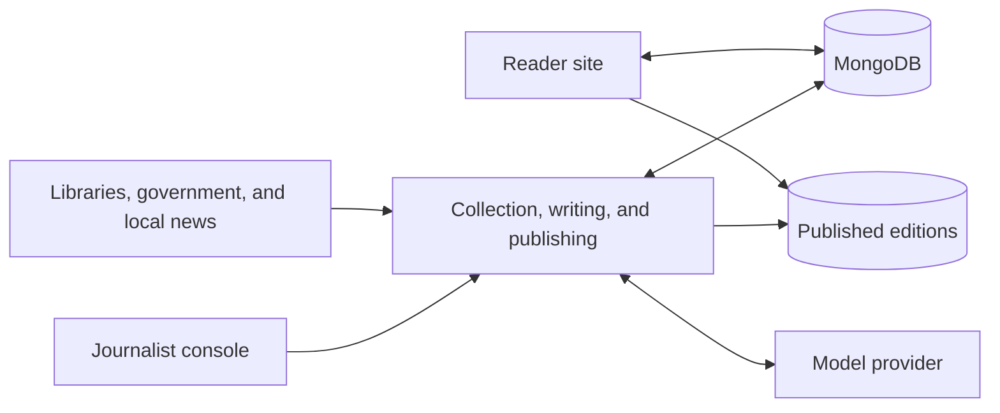
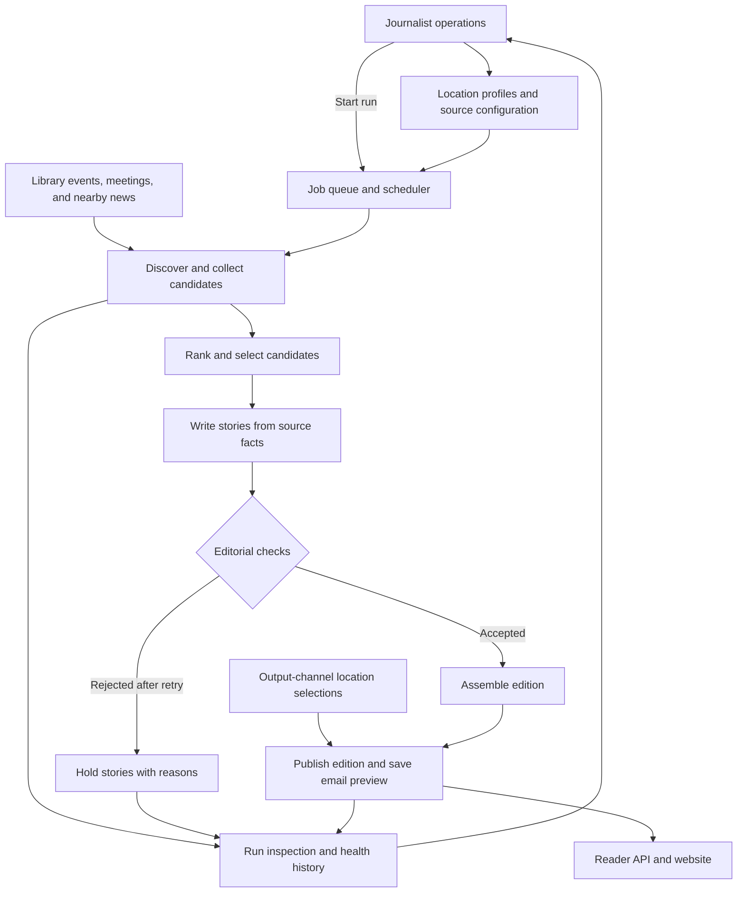

# Newsbee

Newsbee turns community events, public meetings, and nearby news into local newspaper editions. It has a journalist console and pipeline, plus a public reader site.

## Architecture

### Components



### Logical pipeline flow



## Run locally

Requirements: Node.js 24, npm 11, and [Ollama](https://ollama.com/download).

From the repository root:

```text
ollama pull qwen3:4b
npm --prefix apps/journalist-site ci
npm --prefix apps/reader-site ci
npm --prefix apps/journalist-site run local
```

Open the journalist console at [127.0.0.1:3000](http://127.0.0.1:3000) and the reader site at [127.0.0.1:4321](http://127.0.0.1:4321). The local launcher starts MongoDB and scheduler ticks; data is stored under `.local/stage2/`. Sign-in is skipped locally. In **Runs & locations**, search for a community, select and add it, then start a run. In **Output channel**, select and save the town to make it available to readers. Email previews are saved, not sent.

## Pages

**Journalist console**

- **Runs & locations** (`/`) — Search for and add a town or neighborhood, start or inspect its pipeline run, and review results. Search all communities to discover locations beyond saved suggestions.
- **Health** (`/health`) — Check system and location status, model usage, and run trends; use it to spot failures and source issues.
- **Connectors & links** (`/sources`) — Review available source connectors and coverage; validate and save a source link for a location.
- **Output channel** (`/output-channel`) — Configure the reader site's published locations and output destination; save changes to expose editions.
- **Administrators** (`/administrators`) — Add or remove access for journalist-console administrators.

**Reader site**

- **Choose your edition** (`/`) — Search saved communities or use **Search all communities** to find another US town or neighborhood. Open an available edition or submit an email to register interest where no edition exists.

## Develop

```text
npm --prefix apps/journalist-site test
npm --prefix apps/journalist-site run lint
npm --prefix apps/reader-site run check
```

For deployment and environment setup, see the [journalist-site guide](apps/journalist-site/README.md) and [reader-site guide](apps/reader-site/README.md). The [production architecture decisions](Docs/production-architecture-decisions.md) describe runtime boundaries. The earlier Python prototype is archived in [archive/python](archive/python/README.md).
