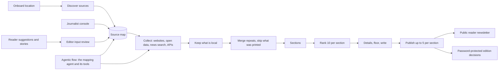

# Newsbee

Newsbee turns a community into a weekly local newspaper edition. Onboard a location and the
pipeline finds that place's sources, reads everything they publish, keeps what is local,
sorts it into newsletter sections, and writes personable stories from the facts. A
journalist workspace runs and debugs the pipeline; a public reader site shows each
community's edition with a source-link dropdown. Editorial source maps stay internal.



One click runs the whole pipeline. You choose the options once, and the **source map** page
then shows every choice the run made, from its first search to the printed edition. Two flows
run side by side, and share everything from assembly onward:

| Step | `current` flow | `agentic` flow |
| --- | --- | --- |
| **Stage 1:** find and save sources | Eleven fixed discovery methods, then the shared Model check and a final review; new sources are `proposed` until a person accepts them (testing phase) | Those, then a goal-driven mapping agent with search, site exploration, page opening and proposing tools, through the same code checks and Model check; new sources are `proposed` with evidence |
| **Stage 2:** read sources for the window | The readers | The readers, plus topic sweeps, tracing stories to original records, and agent extraction for pages the readers can't parse |
| Assemble, rank, write, publish | Shared | Shared; the primary source leads a merged story |

## Scraping rules

Every kind of scraper reads one set of editable rules in [playbook/](playbook/README.md): the fixed
discovery methods, the mapping agent, the Google-operator search services, and Tavily and Exa through
an adapter. [playbook/rules-overview.html](playbook/rules-overview.html) is the readable copy. Safety
and legal rules stay locked in code. Each run records the rules' version.

## Run locally

**1. Install** Node.js 24 with npm 11, and [Ollama](https://ollama.com/download) if you
want a local model. Check with `node -v` and `npm -v`.

**2. Choose a model.** Put settings in `apps/journalist-site/.env.local` (git-ignored; never
commit keys):

```ini
# Hosted model (recommended: faster and better writing). Ollama is the fallback.
NEWSBEE_MODEL_PROVIDERS=gemini,ollama
NEWSBEE_GEMINI_API_KEY=your-key-from-aistudio.google.com
NEWSBEE_GEMINI_MODEL=gemini-flash-latest

# Local model only: leave the lines above out, then run `ollama pull qwen3:4b`.
# Ollama must be running (the Ollama app, or `ollama serve`) at:
NEWSBEE_OLLAMA_URL=http://127.0.0.1:11434
NEWSBEE_OLLAMA_MODEL=qwen3:4b

# Optional
NEWSBEE_VOICE=lively                         # plain | lively | bold
NEWSBEE_RANKING=v5                           # v5 | classic
NEWSBEE_GEMINI_LIGHT_MODEL=gemini-flash-lite-latest   # a Gemini provider's light model: extraction, discovery, the agent and the model check
NEWSBEE_MODEL_DAILY_CALLS=800                # cap for extraction and discovery (stay under your free tier)
NEWSBEE_NEWS_SEARCH=gdelt                    # gdelt | llm | gdelt,llm | off
NEWSBEE_LLM_DISCOVERY=on                     # a model suggests sources at discovery; each is checked
NEWSBEE_PROPOSED_UNTIL_APPROVED=on           # testing phase: map runs save every source as proposed; editions read only accepted ones
NEWSBEE_SOURCE_RUNS_ISOLATED=on              # testing only: every source run starts from scratch and leaves the source map alone
NEWSBEE_INTERNAL_PASSWORD=<set-a-private-password> # internal maps for people without an account
```

Other OpenAI-compatible APIs (OpenAI, Groq, Azure) are listed under
[Model providers](apps/journalist-site/README.md#model-providers).

**3. Start** from the repository root:

```text
npm --prefix apps/journalist-site ci
npm --prefix apps/reader-site ci
npm --prefix apps/journalist-site run local
```

This starts a local MongoDB, the console at http://127.0.0.1:3000 (no sign-in on
localhost), the reader at http://127.0.0.1:4321/reader and a scheduler tick every 5 s.
Data lives under the ignored `.local/stage2/` (MongoDB and a local stand-in for Drive).
The first run downloads MongoDB, and the first location search loads the Census and
library directories, so allow a minute or two. Stop with Ctrl+C.

**4. Make an edition.** In **Location workspaces**, search for a town or a neighbourhood (for example
`Ballard, Seattle`, then **Search all communities**), add it, and open its workspace. In
**Collect sources**, click **Start source run**, then accept or reject the pages it found. Manage
the saved inventory separately in **Sources**. In **Collect stories**, click **Collect stories**.
It reads the map, collects items, ranks candidates, writes stories and prepares the edition with no
further clicks, and stops there: nothing reaches the reader yet. In **Publish**, review it and click
**Publish** to put it on the reader page; **Edition map → Edition funnel** shows every choice it
made. **Videos** then makes short videos from the published stories (owner only). The **Newsroom** page shows every location and its next step. Choose **Manual** run mode to stop
after collection and after writing, for debugging one stage.

Paid services are off until you tick them for a run, so with the defaults a run makes no paid
calls and uses Ollama. See [Run options](#run-options) and [APIs and paid calls](#apis-and-paid-calls).
In the journalist workspace, **Operations → Environment & API settings** stores personal
provider keys. All non-owner journalists must configure the personal keys needed by an action;
deployment API credentials never fill their missing keys. Only the exact configured owner may
use deployment defaults or personal overrides. Browsing and other keyless actions stay available.

**Troubleshooting:** "No model provider can serve requests" means the API key is missing or
wrong, or Ollama isn't running or the model isn't pulled (`ollama list`). Hosted models can
rate-limit; runs pause and resume automatically.

## Run options

Config sets the defaults; the kick-off panel overrides them for one run. The choices are saved
on the run, so a resumed run keeps them.

| Setting | Values (default first) | Controls |
| --- | --- | --- |
| `NEWSBEE_RUN_MODE` | `autopilot`, `manual` | Whether a run stops after collection and after writing |
| `NEWSBEE_PIPELINE_FLOW` | `current`, `agentic` | An edition's flow: agentic adds topic sweeps |
| `NEWSBEE_MAP_FLOW` | `current`, `agentic` | A source map run's method: agentic adds the mapping agent after the fixed pipeline. Defaults to the flow above |
| `NEWSBEE_GUARDRAIL_PROFILE` | `strict`, `exploration` | Editorial and quality rules |
| `NEWSBEE_GUARDRAILS_OFF` | `caps` (default), `quality`, `sensitive`, `topic_content`, `none` | Turn off groups without full exploration. Unset means caps off, so nothing is capped; `none` turns every group back on. See [Limits](apps/journalist-site/README.md#limits) |
| `NEWSBEE_ACCESS_POLICY` | `respect`, `relaxed` | Site preference rules. `relaxed` is a test option, allowed locally and deployed; each run records which it used, since Relaxed and Respect results aren't directly comparable |
| `NEWSBEE_ACCESS_IGNORE` | `robots`, `ai_optout`, `noai`, `nosnippet`, `terms`, `never_read` | Which rules relaxed skips; empty means all of them |
| `NEWSBEE_COUNT_HISTORY` | `on`, `off` | Whether the run updates the no-repeat ledger and edition window; turn off for comparison runs |
| `NEWSBEE_PAID_ALLOW` | Service ids | Which paid services a run may call; empty means none. `model` is every hosted model call, on whichever configured provider serves it (`gemini` and `openai_compatible` still mean `model`) |
| `NEWSBEE_PAID_BUDGETS` | For example `serpapi:200` | Maximum calls per run |
| `NEWSBEE_EXTERNAL_OFF` | Service ids | Free external APIs to switch off |
| `NEWSBEE_SEARCH_PROVIDER` | `serpapi`, `searchapi`, `brightdata`, `exa`, `tavily`, `fixture` | The search behind the agentic flow; `fixture` is a free, local-only test that answers from the location's own source map |
| `NEWSBEE_URL_CLASSIFIER` | `off`, `shadow`, `jev` | Whether Jev scores are ignored, recorded or used |
| `NEWSBEE_PRIORITY_TOPICS` | `crime`, `deaths`, `events`, `home_sales`, `sports`, `government`, `schools`, `business`, `community`, `news` | Topics that drive search and the coverage report; default all |
| Story limit (kick-off panel only) | A number | Write at most this many stories, for quick test runs on a local model |
| Model check (kick-off panel only, `gemini_check`) | on, off | Map runs: the shared Model check and the final review. Off is for baseline tests (the fixed pipeline alone), locally or deployed; each run records it |

**Exploration** flags items instead of dropping them, and each records what strict would have
stopped. Caps come off, locality and validator failures are kept and flagged, and home sales,
death notices and sports reprint what is available. A story that doesn't name the place or its
city is still dropped, so state, national and foreign news stays out. Names of minors in crime stories, names of
sexual or domestic violence victims, and suicide method are still removed. Source discovery
ignores the quality switch: its Quality checks are always on (see the four check groups under
[How sources are found and read](#how-sources-are-found-and-read)).

**Relaxed** skips robots.txt, AI opt-outs, `noai` and `nosnippet` tags, the terms check and the
never-read list (Facebook, Nextdoor, Instagram, X, Reddit, TikTok and Legacy.com), or only the
ones ticked. Each source and item records which it skipped. It is for local runs only: a deployed
environment refuses it, the same way it refuses the fixture search provider. Paywalled text, login
walls, crawl delays and the private-address check stay on, and no anti-bot evasion is used. Ignoring site preferences can breach a site's terms, and
copyright can still apply.

Both **publish like any other run**, locally and when deployed, so on a deployed environment
their stories reach live readers. They count toward story history unless you untick it for a
comparison run. Stored text from relaxed runs can't feed other runs, and
`DELETE /api/admin/relaxed-content` removes that text and the collected items, but not editions
already published.

## APIs and paid calls

Every paid call goes through one gateway (`pipeline/trace/gateway.ts`), which checks the run's
allowance and budget, then logs the call. Unticked or over budget, the step is skipped and
logged, and the run continues. A service with no key stays off. Costs are estimates.
Search, scraping and classification services default to 20 calls a run, to fit free tiers;
model services keep larger budgets, because one edition makes hundreds of model calls. There is no
fixed batch of template searches: operator search is one of the mapping agent's tools, and it
spends the search budget one query at a time.

### Hard limits for free-tier testing

On top of each run's budget, these limits keep testing inside the free plans. They are playbook
values (`general.stop.limit_*` and `general.stop.run_minutes` in
[playbook/general.yaml](playbook/general.yaml)), so anyone can read and change them, and the
gateway enforces them. They are ceilings, not quotas: they stop a run cleanly, and don't gate
quality. Per-second and per-minute limits make calls wait; the others refuse them. When one of
Gemini's limits or the whole-run time is reached, a source map run stops starting new work, keeps
what it found, and records which limit stopped it in the decision log. Any other service's limit
only makes that service unavailable for the rest of the run (a `service_unavailable` decision),
and the mapping agent carries on with its other tools. Gemini's day resets at midnight Pacific.

| Service | Limits |
| --- | --- |
| Gemini | 8 calls a minute; 150 a run; 450 a day across all runs, whichever budget or role a call is under |
| Bright Data | Search: 60 a run, 10 a minute. Opening pages (Web Unlocker): 50 a run. 4,000 a month for both |
| SerpApi | 40 an hour; 200 a month |
| SearchApi | Not used by default; only the run's own budget applies |
| Tavily | 60 credits a run (a basic search costs 1); at most 2 site explorations a run; 30 a minute; 900 credits a month |
| Exa | 60 searches a run; 2 a second; a monthly spend guard of $8, from each search's reported cost |
| Jina Reader | 60 pages a minute with a key, 15 without |
| ScrapingBee | Not used in agent runs; 100 pages a run; 180 in total |
| Our fetcher | One page at a time per site, at least 1 second apart, longer when the crawl delay asks |
| Whole run | 45 minutes for a source map run |

Run limits and the whole-run time apply to source map runs (Pipeline 1); hour, day, month and
total limits count every run. Each count is taken in one conditional write before the call is
made, so calls running at the same time can't overshoot it. A new day or month count starts from
what `api_calls` already records for it. The counts live in `run_budgets`.

| Service | Key | Used for | Cost |
| --- | --- | --- | --- |
| SerpApi | `NEWSBEE_SERPAPI_API_KEY` | Google operator search | Paid |
| SearchApi | `NEWSBEE_SEARCHAPI_API_KEY` | Google operator search | Paid |
| Bright Data | `NEWSBEE_BRIGHTDATA_API_KEY`, `NEWSBEE_BRIGHTDATA_ZONE` | Google operator search (the agent's dorking tool) | Paid |
| Bright Data page opening | `NEWSBEE_BRIGHTDATA_API_KEY`, `NEWSBEE_BRIGHTDATA_UNLOCKER_ZONE` (or a personal profile's Web Unlocker zone) | Paid fallback for opening pages, ticked on its own (`brightdata_open`); getting past a site's block only under Relaxed access | Paid |
| Exa | `NEWSBEE_EXA_API_KEY` | The agent's meaning-based search | Paid |
| ScrapingBee | `NEWSBEE_SCRAPINGBEE_API_KEY` | JavaScript-rendered pages for the fixed readers, anti-bot options off; never in agent runs | Paid |
| Jev (TypeSafe) | `TYPESAFE_API_KEY` or `OPENROUTER_API_KEY`; `NEWSBEE_JEV_MODEL` | Classifying results, pages and items | Paid |
| Agent model | The model provider's key | Agent planning and extraction on a hosted model | Paid unless on Ollama |
| ATTOM | `NEWSBEE_ATTOM_API_KEY` | Home sale prices, if county records are thin | Paid |
| fal.ai | `FAL_KEY` | Video generation; owner can override the deployment value in API settings | Paid |
| Gemini (or any configured model provider) | `NEWSBEE_GEMINI_API_KEY` | Writing, ranking, extraction, discovery and the model check, on the configured providers in order | Paid or free tier, by key |
| OpenAI-compatible APIs | `NEWSBEE_LLM_<NAME>_*` | Model fallback | Paid |
| Tavily | `NEWSBEE_TAVILY_API_KEY` | Council documents, the agent's AI search and site exploration | Free tier, then paid |
| Ollama | None | Local model fallback | Free |
| GDELT, Overpass, Nominatim, Socrata, NWS, Wikidata, Bluesky, county records | None | Public data | No key; logged, with an on/off switch |

These integrations are connected but haven't been called with real keys yet, so expect to adjust
them once keys are set. In particular, Jev's direct endpoint and ATTOM's response fields come
from third-party references and summaries.

## Priority topics

Each location should pull ten topics, one for each category a source map covers. They drive query
generation in both stages, each with a guaranteed share of the query budget, and each run reports
its coverage of them. Weather is not one of them.

| Topic | Sources | Prints as |
| --- | --- | --- |
| Crime, police and safety | Police and fire data, sheriff and police blotters, prosecutors | Stories |
| Obituaries | Funeral homes, family submissions | Compact list; strict prints name, dates and service details with a link |
| Events | Venue, parks, library, school and neighbourhood calendars | Events |
| Real estate and home sales | County sales files and datasets (`property` reader), city permits, ATTOM if a key is set and the run ticks it | Compact list; strict leaves out buyer and seller names |
| Sports, including school sports | School athletics, state associations, local teams and leagues | New Sports section; scores as a compact list |
| Council and government | Agendas and minutes, hearing notices, boards and commissions, meeting platforms | Stories |
| Schools | District sites, school board meetings and calendars, PTA, PTSA and PTO pages | Stories |
| Business | Chambers, downtown groups, city business pages, licences, news of openings and closings | Stories |
| Community | Neighbourhood councils, nonprofits, service clubs, volunteer centres | Stories |
| Other local news | Local papers, neighbourhood blogs, city news pages | Stories |

Each county publishes sales differently, so home sales coverage varies most. Merchant discounts
have no public feed: the fixed methods can reach a chamber or downtown group's pages, but only
search can look for offers themselves.

A map run ends by counting sources for the ten editorial categories (events, council, schools,
sports, safety, real estate, business, community, other news, obituaries) and naming any that came
up empty. National readers are counted apart, so they can't hide a gap. See **Sources by category**
in the Edition funnel, and **Source map → Source runs** for each map run's categories. Weather stays a section outside that list.

## How sources are found and read

Each location has a **source map** (MongoDB `source_map`), built by discovery methods that
run when due (each has its own refresh period) and edited by editors. Collection reads only
from the map. Onboarded profiles and source inventory live in MongoDB; optional reviewed
community overrides and connector defaults are not an exhaustive location/source catalog.

The **fixed pipeline** is one list of readers that runs before the agent, and every page it adds
goes through the same page checks as a search result. The run funnel shows what it found in each
category. Model suggestions are no longer part of it: the agent replaces them.

| Fixed reader | Finds |
| --- | --- |
| City and county | Official sites (checked city site, OpenStreetMap, Wikidata) read in depth: their home pages, category pages (agendas, hearings, boards, police and fire, permits, business, parks, volunteering), CivicPlus feeds and the groups they link to; and their Legistar, CivicClerk and PrimeGov accounts |
| Open data | Socrata datasets for police and fire calls, permits, inspections, licences and 311 |
| Schools | The districts covering the place (Census, NCES directory), their board meetings, calendars and news, and local schools' PTA, PTSA or PTO pages |
| Local groups | Chambers, downtown and neighbourhood groups at their usual addresses, and funeral homes' obituary pages |
| Local institutions | Libraries, police and fire stations and community centres, and the clubs and high schools serving the place from just outside it, read in depth for their events, news and notices pages; the home pages of other places on OpenStreetMap inside the area (town halls, courts, venues, museums, newspapers, nonprofits) |
| News and wider sources | Wikidata outlets published nearby with a current feed, outlets news search keeps finding covering the place, the state athletic association, and the national readers: NWS, USGS, EPA, Census, Justice Department, Wikipedia, library systems, reader stories, family notices |
| Home sales | ATTOM sale prices, only when a key is set; collection calls it only in runs that tick it |

| Agentic flow | Finds |
| --- | --- |
| Mapping agent (agentic flow) | A researcher with tools, working one step at a time towards a goal: every category has at least one source the model check accepted, or a record of what was tried. It starts from what the fixed pipeline found, as a live checklist, and picks each step: search (dorking through Bright Data or SerpApi, Exa, or Tavily), explore a confirmed site with Tavily, open a page, propose a source, or mark a category not found once it has tried it enough (8 searches across 2 tools). There is no set number of steps, searches or pages. Proposing is the only way it saves anything, and it runs the code checks and the shared Model check on the live page first. It stops when every category is covered or not found and its last 10 steps found nothing new, or at a ceiling (Gemini's limits, the run's model budget, 45 minutes); a tool at its own limit only becomes unavailable. Progress is saved after every step in `agent_state`, so one session carries on across 200-second `agent_round` jobs. Every step (action, tool, query or page, reason, result) is a decision with stage `agent`, and every source keeps the tool, query and step that found it and the reader that opened it (`found_by`). It uses the light model (`NEWSBEE_GEMINI_LIGHT_MODEL`). Its instructions are [skills/map-sources/SKILL.md](skills/map-sources/SKILL.md) and the playbook's `general.search.agent_prompt`, tool practices (`agent_tools`) and research habits (`research_habits`, `habit_examples`) | Every agentic run |

Sources carry a `source_tier`: `official`, `organisation`, `business`, `local_reporting` or
`repost`. Primary sources lead merged stories, rank higher in each section, and lead the edition,
with local stories first and then priority topics. Original local journalism keeps its place, and
only rewrites are demoted. Each priority topic has its own allowance of city-wide stories.

Before an agentic source is saved, it is tested:

- **Exact page:** the page itself is the source, so a city's agenda centre and calendar stay separate. A single dated story becomes its listing page.
- **Coverage:** each source records its `scope`: `place`, `city` or `county`. A county source is kept if it is first-party, and each of its items still has to pass the locality filter.
- **Format:** it looks for a working feed or calendar, recognising platforms such as CivicPlus, Trumba, Google Calendar, WordPress and Squarespace, and parses each one before believing it. It records a `source_kind`: `feed`, `calendar`, `dataset`, `document_list`, `listing` or `lookup`.
- **Current:** a page with plenty of dates, all old, is rejected. Lookup forms, dashboards and pages with no dates stay as links for editors and aren't read.

The checks fall into four groups (`apps/journalist-site/pipeline/discovery/checks.ts`):

| Group | Rules | Can it be switched off? |
| --- | --- | --- |
| Safety | Never open private addresses; follow crawl delays | Never |
| Quality | Reject known repost and aggregator sites, and pages clearly about another place | Never in Pipeline 1 discovery, whatever the run's guardrails |
| Access | Robots, AI opt-outs, `noai` and `nosnippet` tags, terms, and the never-read list | Yes, by the Access setting: Respect follows them, Relaxed skips them |
| Evidence | Locality and freshness facts | Not a pass-or-fail rule |

Evidence is facts for a later Model check. **Locality** records which of the place, city or
county the page names and where (title, text or an address), whether it is on the confirmed
official site or an institution found by location, and the addresses it lists, inside the area or
not. **Freshness** records each date found and where it came from: page markup, visible text, a
feed, the server's `Last-Modified` header or the sitemap's `lastmod`. Code decides only clear
cases: a clear pass, or a clear fail (a page clearly about another place, or one with plenty of
dates, all old). The rest are marked `unclear`, and the model check decides them. The facts are
saved on the source as `checks` and in the decision log. Each page check in the log also records
the route that found it (`method`), the reader that opened it and the readers tried first with why
(`fallbacks`: the fetcher's thin text, Jina returning nothing), and the source it became, so the
Source runs tab can show every page without guessing; the agent's open steps record the same.

### The model check, the final review and saving

Every source from every route (the fixed readers, operator search and the agent) is judged by one
shared Model check (`apps/journalist-site/pipeline/discovery/gemini-check.ts`), a separate call
on the light model, so the agent never grades its own work:

| | |
| --- | --- |
| Question | Does it keep publishing new, useful local information? Is it the right page, and does it really serve this community? Hard facts (robots, rights, dates, place names) are code's evidence, not re-decided; a clear code failure never reaches it, and what code marked `unclear` is decided here |
| It sees | Up to 1,500 characters of page text, recent item titles, how many dated items appeared lately, the code checks' facts, the category's keep and reject rules and examples from the playbook, and a few of the editor's past Accept or Reject decisions (`source_reviews`). Structured sources (datasets, meeting-system accounts, CivicPlus feeds, national readers, ATTOM) are judged on what they contain and when they last updated |
| It returns | Accept or Reject, an A or R reason code (`pipeline/sourcemap/reasons.ts`) and the quote or date it relied on, saved on the source as `gemini` and in the decision log |
| Limits | No cap on how many are judged: 25 sources a call (`general.stop.gemini_check_batch`), paced and limited by the gateway's Gemini hard limits (8 a minute, 150 a run, 450 a day), at temperature 0 |
| Failure | A failed call or a hard limit leaves the rest unjudged: they are saved as `proposed` with a note, never live. Those the job had no time for are held, with their page text (`pending_checks`), for the run's next job: the next agent job, or the final review, which takes as many jobs as it needs. A verdict missing from a reply is asked for once more |
| Repeat runs | Only sources that are new, or whose details (address, feed, kind, category, scope, check outcomes) changed since they were judged. A source a person labelled is never re-judged |
| Off switch | The `gemini_check` run option, for baseline tests, locally or deployed (like Relaxed, the run records it). With it off, an `unclear` page is rejected by code as before |

After every route has finished, a **final review** (`review_map` job, `pipeline/discovery/final-review.ts`)
goes through the location's new sources category by category. Code finds likely duplicates (the
same feed, a page and its own feed, the same site, shared recent titles, or a meeting-system
account beside an agenda page), the model confirms them, and each new source is marked `strong`,
`usable` or `weak`. It only adds `review_flags`: it deletes nothing and changes no status.

**Proposed until approved (testing phase).** While `NEWSBEE_PROPOSED_UNTIL_APPROVED` is on (the
default), every source a map run finds, including the fixed pipeline's, is saved as `proposed`,
and no edition, current or agentic, reads a proposed source: only what a person accepted, plus
sources that were already live (active, pinned or dormant). A model check rejection is saved as a row
with Initial Status Rejected and the model's reason, so a person can overrule it; clear code failures
stay in the decision log only. Pinned, paused and dormant sources keep their status, and a person's
decision stands on later runs. Set it to `0` after the testing phase to let the fixed pipeline's
sources go live again and agentic editions read proposed ones.

**Test mode: every source run from scratch (testing only).** While `NEWSBEE_SOURCE_RUNS_ISOLATED`
is on (the default for now), a source map run builds its results for that run alone, so test runs
on one place can be compared and none of them changes All sources or any edition:

- It reads every fixed reader again, into its own store (`source_run_<run id>`, the same records
  the source map holds), and the agent's checklist starts from what this run accepted, never from
  the map. Nothing is written to `source_map`, `discovery_state`, saved addresses or the
  location's map version.
- Nothing from earlier runs is reused: search results are reused only within the run, sources
  already judged are judged again, and lists of sources (Wikidata newsrooms, athletics feeds) are
  found again. Facts about the place itself may be reused (`PLACE_KINDS` in
  `pipeline/discovery/cache.ts`: its boundary and landmarks, institutions, city website, school
  districts and nearby topics), as are robots.txt, crawl pacing and the fetcher's 30-minute page cache.
- Each run keeps its own complete results: its sources with the model check and the final
  review's flags, the decision log with every page's trace, the agent's log and the settings it
  used. Reopening a past run shows exactly what it found.
- Decisions carry across runs by page: Accept or Reject and the reason are kept for the location
  and the page's normalised address (`page_decisions`) and show on that page's row in every run,
  past and future; bulk decisions too. They also go to `source_reviews`, so they are the model
  check's examples, and the agent doesn't propose a page you rejected again. All sources decisions
  are kept by page as well.

Set it to `off` to roll back: map runs write into the source map as before, and Source runs reads
them from it. Runs made in test mode stay readable either way.
- **The city's website:** the address on a location is checked as really being the city's before any `site:` query uses it, and corrected if not.

To run the agent from a harness instead, [opencode.json](opencode.json) connects
`apps/journalist-site/scripts/newsbee-tools-mcp.mjs`, an MCP server giving it `place_profile`,
`coverage`, `search`, `fetch_page`, `list_site_links`, `find_endpoints`, `test_source`,
`check_rights`, `classify` and `propose_source` through the running local stack. Set
`NEWSBEE_AGENT_LOCATION` to a location id. `propose_source` runs the checks above and saves what
passes as `proposed`.

To compare a source map with a list people researched by hand, run this. The list stays outside the
code, because discovery has to work for any location. Set `NEWSBEE_MONGODB_URI` to score a deployed
database:

```bash
cd apps/journalist-site
node scripts/score-sources.mjs <location id> <file of URLs, one per line>
```

[opencode.json](opencode.json) and [.mcp.json](.mcp.json) also connect SearchApi's own MCP server,
for its other engines such as Google Maps and Google Events. Set `MCP_TOKEN` to your SearchApi MCP
token. Its calls go straight to SearchApi, so they count against your SearchApi plan but skip the
run's budget and API log. Pipeline runs don't use it: they call SearchApi through the gateway with
`NEWSBEE_SEARCHAPI_API_KEY`.

| Reader | What it reads |
| --- | --- |
| `web` | Any website: feed, iCal, schema.org data, recent sitemap pages and story links (up to 10 robots-checked requests within a two-minute site budget, with 15-second network timeouts); full text kept 30 days for details and locality |
| `opendata` | Any Socrata dataset on the map; police and fire calls become incidents with plain-word call types, block-level places and unit counts |
| `newssearch` | GDELT news search for the place (web-grounded model search optional) |
| `sweep` | Agentic runs only: `after:` operator queries per priority topic, and tracing secondary stories to original records. Each result is fetched and checked |
| `property` | Recorded home sales with prices: county data files, open-data sales datasets and, when ticked, ATTOM |
| `library`, `meetings`, `hazards`, `trending`, `homesafety`, `housing`, `justice`, `community`, `remembrance` | The existing API readers |

Slow websites retain already collected items and defer remaining pages when their time
budget is reached. Publisher crawl delays are honored in full; a request is deferred if
its required wait would exceed the budget. The source detail reports limited collection.

Each reader type has a **lookup window**: news-like sources read since the last edition
(capped per type), events read ahead. Stories printed before are skipped unless they bring
new facts (printed as an update); events print at most twice. Items must show they concern
the community (coordinates, a source inside the area, naming it or a landmark, an address
inside it, or the article text). Crawling guardrails: robots.txt and AI-crawler opt-outs,
`noai`/`noindex` and mining reservations, paywalls kept to headline and link, crawl-delay,
back-off, and no Facebook, Nextdoor, Instagram, X, Reddit, TikTok or Legacy.com.

## Sections, ranking and writing

- **Sections:** events, council and government, schools and youth, local sports, police fire and safety,
  real estate, business, obituaries, community, weather and other news. Copies of one story
  from different sources are merged and every source is credited.
- **Ranking (v5, per section):** rules order each section, the model rates its top 15, a
  per-community bandit learns what readers open and share, an editor-style pass reorders,
  and a variety pass limits one source to 3 per section. The top 10 per section are
  written; up to 5 per section are published.
- **Writing:** a light-model call extracts each story's details (people, places, numbers,
  what happened, a short quote, the next step), and the writer leads with them. Every draft
  is checked against the source. The **floor** keeps allegations worded as allegations, no
  names of minors or victims in crime stories, no house numbers (block level), and no
  suicide method details; crime, arrests, deaths and court cases are otherwise ordinary
  stories. Students and other minors may be named in a positive light.

## Pages

- **Journalist workspace:** the Newsroom hub, location workspaces (Overview
  with alerts and their fixes, Sources, Collect sources, Collect stories, Publish and Settings), the Editorial
  inbox, and Operations (System, Storage, Clear data, Users, settings and approvals). Sources are
  edited only in a location's **Sources** tab.
- **Internal maps:** `/source-map` has **All sources** (the source network) and **Source runs**:
  read each source map run page by page (settings it used, how it ended, limits, stages, every page
  with its checks and verdicts, by tool, the agent log, and a comparison with another source run). `/edition-map` shows one funnel per run, from the first search to the final
  edition, for either flow: who decided, when and why at each stage, one item's full trail, topic
  coverage, cost per service and a comparison of two runs.
  `/interest-usage` shows distinct edition-view,
  subscription-signup and interest-signup metrics on a geographic heat grid and exact-count
  table, with date/location filters and explicit history limits. All three open inside the workspace
  for a signed-in journalist, or behind `NEWSBEE_INTERNAL_PASSWORD` for anyone without an account.
  Maps are read-only for everyone: source runs are started, and pages and sources accepted or
  rejected, only in a location's workspace, under **Sources**.
- **System → Model usage** (`/health?view=usage`, administrator-only): calls, reported input/output
  tokens and estimated USD cost by actual model, location, pipeline role and UTC day,
  with rolling 24-hour/7-day/30-day filters. Historical calls without location stay
  unassigned; missing tokens or prices are excluded from the priced subtotal, not
  assumed free. Configure both per-model input/output rates or exact-model
  `NEWSBEE_MODEL_PRICING` overrides; see [pricing and limits](Docs/deployment.md#model-usage-pricing).
- **Reader site** (`/reader`): community search and published editions, source-link dropdown,
  source suggestions, story sharing/reporting, weekly-update signup and family remembrances.
  Internal source decisions are not rendered or linked publicly.

## Develop and deploy

```text
npm --prefix apps/journalist-site run lint
npm --prefix apps/reader-site run check
npm --prefix apps/journalist-site test   # includes isolated, in-memory MongoDB workspace tests
npm --prefix apps/journalist-site run build
npm --prefix apps/reader-site run build
```

The first MongoDB-backed test run may download a MongoDB binary. These checks do not
prove live source availability, provider billing accuracy or production credentials.

Both apps deploy as one Vercel project from the repository root (only `main` deploys;
previews are off). See [Docs/deployment.md](Docs/deployment.md) for environment variables
and Drive setup, the [journalist guide](apps/journalist-site/README.md) and the
[reader guide](apps/reader-site/README.md). The earlier Python prototype is archived in
[archive/python](archive/python/README.md).
