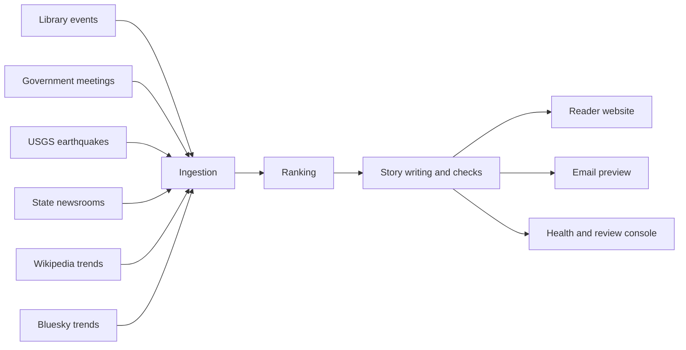

# Newsbee
CSE589 UW Entrepreneurship Prototyping

Newsbee is a local Stage 1 prototype of an automatically written weekly community newspaper.
For each onboarded town it:

1. pulls the coming week's library events and local government meetings, plus nearby
   earthquakes, state newsroom announcements and trends about the town, county or nearby places,
2. ranks them and has a local model (Ollama, `qwen3:4b`) write short stories,
3. holds any story that fails its checks, and publishes the rest to a reader website,
4. emails a preview to test subscribers (captured locally by Mailpit).



## Setup

Install [uv](https://docs.astral.sh/uv/getting-started/installation/),
[Node.js 24](https://nodejs.org/en/download),
[Mailpit](https://mailpit.axllent.org/docs/install/) and
[Ollama](https://ollama.com/download), then:

```text
ollama pull qwen3:4b
uv run --locked python scripts/dev.py setup --browser
uv run --locked python scripts/dev.py up
```

In a second terminal, add a town and publish its first edition:

```text
uv run --locked python scripts/dev.py setup-directory
uv run --locked python scripts/dev.py onboard edmonds-wa
uv run --locked python scripts/dev.py ingest-events
```

| Page | URL |
| --- | --- |
| Reader website | http://127.0.0.1:4321 |
| Journalist admin | http://127.0.0.1:3000 (start separately; Google OAuth and MongoDB must be configured) |
| Health dashboard and review | http://127.0.0.1:8000/review |
| API docs | http://127.0.0.1:8000/docs |
| Email previews (Mailpit) | http://127.0.0.1:8025 |

The local API and reader are localhost-only. Journalist access requires an enabled account
in MongoDB; see `projects/journalist-site/README.md`. Logs go to `.local/logs/`.

To run the journalist admin separately, configure the Google OAuth and backend variables
listed in `projects/journalist-site/README.md`, then run `npm install` and `npm run dev`
from `projects/journalist-site`.

The backend defaults to local Ollama. Set `NEWSBEE_MODEL_PROVIDER=gemini` and
`NEWSBEE_GEMINI_API_KEY` to use Gemini; see
[production architecture decisions](Docs/production-architecture-decisions.md) for hosting
and storage boundaries.

## Commands

Prefix each with `uv run --locked python scripts/dev.py`:

| Command | Does |
| --- | --- |
| `find-location Edmonds` | Find a town's id |
| `onboard <id>` / `remove-location <id>` | Add or remove a town |
| `ingest-events` | Fetch sources and publish editions for every town |
| `author-edition <id>` | Re-write one town's edition |
| `withdraw-story <edition id> --story <story id> --reason "..."` | Remove a published story with a correction |
| `events` | List jobs and stored events |

If `onboard` can't find a town's library website or meeting platform, add it to
`config/library-websites.json` or `config/government-sources.json` and re-run it.

## Sources

Each source is a separate connector: free, keyless, public and robots.txt-permitted. A failing
source shows on the health page but never blocks the town's edition.

| Connector | Pulls | Validation |
| --- | --- | --- |
| Library events | Next week's events from the town library's calendar | Size, count and HTTPS-link limits; repeated events merged into one story |
| Government meetings | Legistar/CivicClerk agendas and outcomes | Same feed limits and HTTPS links |
| `hazards:usgs` | USGS earthquakes within 50 km, past 14 days | M3.0+ or 10+ felt reports; quakes near the same place merged |
| `statenews:wa` | State newsroom RSS (Governor, WSDOT, AG, DOH), past 14 days | Must name the town, county or a nearby place; crime and death topics dropped |
| `trending:wikipedia:wa` | Wikipedia pageview spikes for nearby places | 1.5–2x usual views and 1,000+/day; sensitive topics dropped |
| `trending:bluesky:wa` | Bluesky trending topics | Must name the town or a nearby place; 100+ posts; no politics; counts only, no post text |

Every written story is held if it adds facts not in the source, uses lists, foreign
characters or unfinished sentences, drops the event's name, or (events and meetings only)
repeats the date. Wider sources fill at most 4 of 9 slots; turn them off with
`NEWSBEE_WIDER_SOURCES=false`.

## Development

```text
uv run --locked python scripts/dev.py test      # offline tests
uv run --locked python scripts/dev.py browser   # browser tests
uv run --locked python scripts/dev.py replay    # Stage 1 replay check
uv run --locked ruff check .
```

| Folder | Holds |
| --- | --- |
| `projects/backend` | API, pipeline modules, shared adapters ([map](projects/backend/README.md)) |
| `projects/website` | Reader site |
| `projects/journalist-site` | Authenticated Next.js operations console |
| `projects/review-console` | Health and review pages |
| `shared/contracts` | Contracts shared between projects |
| `config` | Source overrides, preview subscribers, policies |
| `tests` | Unit, integration, end-to-end ([map](tests/README.md)) |
| `Docs` | [Design spec](Docs/newsbee-design-spec-v1.html), [roadmap](Docs/newsbee-implementation-roadmap-v1.html) |