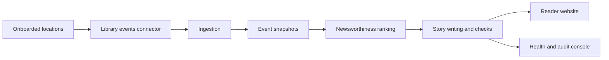

# Newsbee
CSE589 UW Entrepreneurship Prototyping

Local Stage 1 prototype of an auto-published community newspaper. Library events are the
first source; editions publish after each ingestion with no human review.



## Setup

Install [uv](https://docs.astral.sh/uv/getting-started/installation/),
[Node.js 24](https://nodejs.org/en/download),
[Mailpit](https://mailpit.axllent.org/docs/install/) and
[Ollama](https://ollama.com/download), then:

```text
ollama pull qwen3:4b
uv run --locked python scripts/dev.py setup --browser
uv run --locked python scripts/dev.py up
```

| Page | URL |
| --- | --- |
| Reader website | http://127.0.0.1:4321 |
| Health and review | http://127.0.0.1:8000/review |
| API docs | http://127.0.0.1:8000/docs |

Localhost only, no authentication. Logs go to `.local/logs/`.

## Commands

In a second terminal (prefix each with `uv run --locked python scripts/dev.py`):

| Command | Does |
| --- | --- |
| `setup-directory` | Download the US library directory (once) |
| `find-location Edmonds` | List matching towns and ids |
| `onboard edmonds-wa` | Add a location and find its library websites |
| `remove-location <id>` | Delete a location and all its data |
| `ingest-events` | Pull 7 days of events from tomorrow, then author editions |
| `author-edition <id>` | Re-author one location |
| `events` | List jobs and stored events |

If a library website isn't found, add it to `config/library-websites.json` and re-run
`onboard`. Library data is for local evaluation only; don't commit or redistribute it.

## Authoring

1. **Deduplicate** repeated events into one story.
2. **Rank** up to 10 randomly sampled stories (civic 3 : appeal 2 : one-off 1).
3. **Write** up to 5 stories, one per category. Drafts that add facts or repeat
   themselves get one retry, then are held for audit at `/review/editions`.
4. **Front** headline about the top story.

## Development

```text
uv run --locked python scripts/dev.py test      # fixtures and mocks only
uv run --locked python scripts/dev.py browser
uv run --locked ruff check .
```

Run `scripts/dev.py contracts` after changing `shared/contracts`. Optional settings
(`NEWSBEE_DATA_DIR`, `NEWSBEE_OLLAMA_URL`, `NEWSBEE_OLLAMA_MODEL`, ...) all have defaults.

| Folder | Holds |
| --- | --- |
| `projects/backend` | API, pipeline modules, shared adapters ([map](projects/backend/README.md)) |
| `projects/website` | Minimal reader site |
| `projects/review-console` | Minimal review and health pages |
| `shared/contracts` | Contracts shared between projects |
| `config` | Library website overrides, policies |
| `tests` | Unit, integration, end-to-end ([map](tests/README.md)) |
| `Docs` | [Design spec](Docs/newsbee-design-spec-v1.html), [roadmap](Docs/newsbee-implementation-roadmap-v1.html) |
