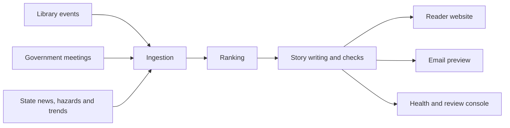

# Newsbee
CSE589 UW Entrepreneurship Prototyping

Newsbee is a local Stage 1 prototype of an automatically written weekly community newspaper.
For each onboarded town it:

1. pulls the coming week's library events and local government meetings and, for news
   deserts, county and statewide news and trends,
2. ranks them and has a local model (Ollama, `qwen3:4b`) write short stories,
3. holds any story that fails its checks, and publishes the rest to a reader website,
4. emails a preview to test subscribers (captured locally by Mailpit).



## Setup

Install [uv](https://docs.astral.sh/uv/getting-started/installation/),
[Node.js 24](https://nodejs.org/en/download),
[Mailpit](https://mailpit.axllent.org/docs/install/) and
[Ollama](https://ollama.com/download), then:

```text
ollama pull qwen3:4b
uv run --locked python scripts/dev.py setup --browser
uv run --locked python scripts/dev.py up
```

In a second terminal, add a town and publish its first edition:

```text
uv run --locked python scripts/dev.py setup-directory
uv run --locked python scripts/dev.py onboard edmonds-wa
uv run --locked python scripts/dev.py ingest-events
```

| Page | URL |
| --- | --- |
| Reader website | http://127.0.0.1:4321 |
| Health dashboard and review | http://127.0.0.1:8000/review |
| API docs | http://127.0.0.1:8000/docs |
| Email previews (Mailpit) | http://127.0.0.1:8025 |

Logs go to `.local/logs/`. Everything runs on localhost with no authentication.

## Commands

Prefix each with `uv run --locked python scripts/dev.py`:

| Command | Does |
| --- | --- |
| `find-location Edmonds` | Find a town's id |
| `onboard <id>` / `remove-location <id>` | Add or remove a town |
| `ingest-events` | Fetch sources and publish editions for every town |
| `author-edition <id>` | Re-write one town's edition |
| `withdraw-story <edition id> --story <story id> --reason "..."` | Remove a published story with a correction |
| `events` | List jobs and stored events |

If `onboard` can't find a town's library website or meeting platform, add it to
`config/library-websites.json` or `config/government-sources.json` and re-run it.

### Wider-area sources (news deserts)

When a town has little local news, editions widen to its county and state. Each source is
free, keyless, public and robots.txt-permitted, with its own adapter and ranking rules:

| Source id | Source | Window | Kept | Ranking |
| --- | --- | --- | --- | --- |
| `hazards:usgs` | USGS earthquake catalog | 14 days, 100 km | M3.0+ or 10+ "felt" reports | town tier (≤30 km), magnitude, distance, felt |
| `statenews:wa` | Official state newsroom RSS (Governor, WSDOT, AG, DOH) | 14 days | 10 per newsroom | town, county, state; practical over ceremonial; publishers interleaved |
| `trending:wikipedia:wa` | Wikimedia pageviews: state watchlist + state-tied most-read | last 3 days vs prior 2 weeks | ≥2x (watchlist) / ≥1.5x (most-read), 1,000+ views/day | town, county, state; biggest spike |
| `trending:bluesky:wa` | Bluesky public trending topics | today | names the town, county, state or a watchlist topic; 100+ posts | town, county, state; most posts |

Items are tagged `local` (names the town), `region` (names its county) or `state`. Local
stories are written first; county then state stories fill at most 4 of the 9 slots, appear
after local ones, and carry a section label (e.g. "Around King County"). Guardrails: deaths,
crime, violence and self-harm topics are dropped; Bluesky politics trends are excluded; no
post text or handles are stored (counts only); calls are bounded and statewide results cached
daily; a failing source shows on the health page but never fails the town's ingestion.
Per-state sources live in `config/state-sources.json`. Set `NEWSBEE_WIDER_SOURCES=false` to
turn them off. Not used: NWS alerts and Wikipedia `api.php` (robots.txt disallows), and
Google Trends, X, Reddit and TikTok (no free, permitted public API).

## Development

```text
uv run --locked python scripts/dev.py test      # offline tests
uv run --locked python scripts/dev.py browser   # browser tests
uv run --locked python scripts/dev.py replay    # Stage 1 replay check
uv run --locked ruff check .
```

| Folder | Holds |
| --- | --- |
| `projects/backend` | API, pipeline modules, shared adapters ([map](projects/backend/README.md)) |
| `projects/website` | Reader site |
| `projects/review-console` | Health and review pages |
| `shared/contracts` | Contracts shared between projects |
| `config` | Source overrides, preview subscribers, policies |
| `tests` | Unit, integration, end-to-end ([map](tests/README.md)) |
| `Docs` | [Design spec](Docs/newsbee-design-spec-v1.html), [roadmap](Docs/newsbee-implementation-roadmap-v1.html) |